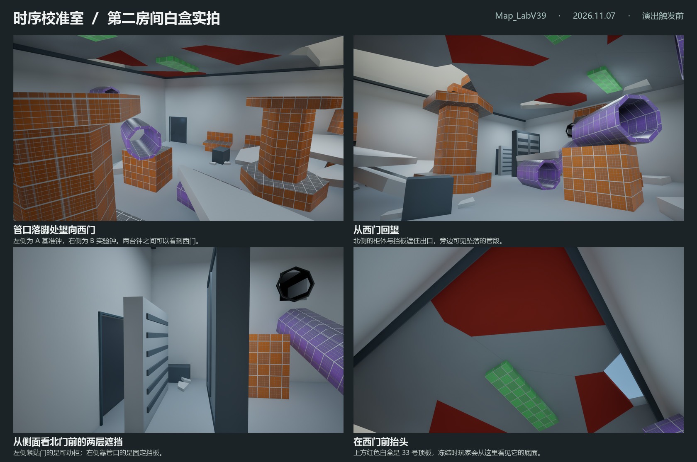
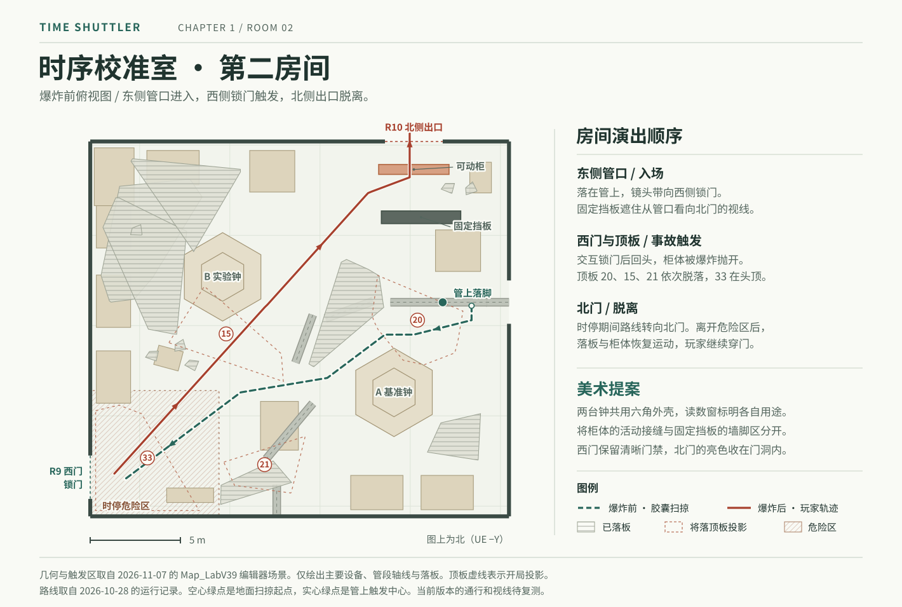

# Chapter 1 第二房间 · 时序校准室

2026-11-07 确定用途为**时序校准室**。第一房间进行时间粒子实验，这里用一台基准钟和一台实验钟比对计时偏差。两台计时仪器就是现有的竖直立柱。灾难发生后，以基准钟继续走时、实验钟停在最后一次测量来交代现场。上层 B 区历史空间表与首轮预览使用工作名「共享实验工作区」（UP）。摆位与视角取自手工编辑的 `/Game/Maps/Map_LabV39`。[室内美术基准](../../Knowledge/project-overview.md#室内美术基准) · [上层 B 区空间表](../../../SourceAssets/LabV39/R17/revised-layout-geometry.json) · [房间现有演出](../../Implementation/chapter1-room2-cinematic.md)

## 原关卡已安装的美术

2026-11-07 已在原图保存并重开。A 基准钟用备用工作灯和走时屏显示时、分、秒；B 实验钟的机械计数器锁定在 `172408`，观察窗右上角碎裂。两台钟保留原六角底座、筒身和宽顶盖的占地。墙边新增双通道相位比较仪及配对探针盘，原管道、滤柜、灯具与记录台换装，受损的 33 号板底面增加检修盖和断开的固定片。墙面使用亮中性灰白，地面和设备底座压暗。[UE 六机位前后实拍与仪表特写](../../../../output/time-shuttler/ch1-room2-installed/index.html) · [可编辑的时钟模型](../../../SourceAssets/Chapter1/TemporalCalibration/TC_ClockInstruments.blend)

引擎复测中，139 个原对象的碰撞与变换、46 处深度探针及 648 个通路采样格与换装前一致。使用实际玩家角色和游戏交互输入触发西门，柜体和四块顶板按原演出冻结，33 号板的检修盖与主体位置误差为 0 cm。爆前管口与西门处均有 0/9 个采样点可见北门，爆后西门处为 9/9。恢复后角色连续移动、开门并穿过门槛。[本轮运行记录](../../../../output/time-shuttler/ch1-room2-installed/verification/pie/result.json) · [改造前备份](../../../../output/time-shuttler/ch1-room2-installed/Backup/checkpoint.json)

时序校准室的五段回风管沿用粒子实验室的八角截面、石墨色外壳、深色内衬和窄金属翻边。东侧斜管顺接低位管段（8 → 9 → 11），入口弯头只有一片外皮翘起，落板下的弯头有一道更深的撕裂。两处弯头内壁均连续。11 → 12 和 12 → 10 分别保留约 3.50 m 和 2.77 m 的原端口中心间距，表现管段在事故中错位。[两房实景及替换前后对照](../../../../output/time-shuttler/ch1-duct-alignment/Ducts.jpg)

## 设计依据与参考图

入口新版试用亮中性灰白墙面。早期的[入口暖灰试色](../../../../output/time-shuttler/ch1-room2-concepts/01-entry-west-door.png)、[爆后北门显露](../../../../output/time-shuttler/ch1-room2-concepts/02-north-door-reveal.png)和[33 号板时停仰视](../../../../output/time-shuttler/ch1-room2-concepts/03-frozen-ceiling.png)保留作构图对照。柜体和顶板在游戏中的实际姿态由运行时物理决定。

## 玩家会依次看到什么

1. **从东侧高管落脚，西门出现在两台设备之间。** 玩家落在室内斜管的入口触发区，镜头收至 60° 看西门，再交还控制。沿用第一房间的深灰八角管和浅色接口，让玩家认出刚刚穿过的系统。西门门框和地面的明暗交界负责引导，中央两台设备在这一刻只需轮廓清楚。
2. **走到西门，才知道门锁住了。** 让门旁状态灯和交互面位于玩家伸手可及的高度，保留现有 `LOCKED` 反馈。靠墙工位已经受损，中央设备和门前保留完整的可走地面，玩家能看见从哪里绕行。
3. **回头看见柜体抛开，房间第二次坍塌。** 北侧可动柜从出口前抛开；较靠室内的固定挡板留在原位。从西门回望，两者的视差揭开北门。前三块顶板依次脱落，最后才抬头看到 33 号板。柜体掀起时，内侧露出的浅色安装面和断开的固定耳能让人读懂原来的连接。
4. **时停发生后，从落板下撤向北门。** 33 号板的断面和底面要能从下方辨认；从西门朝北门看，门框要在静止的柜体、板块之间可读。出危险区后物体恢复运动，角色仍能接近、打开并通过北门。

## 白盒各块如何落成资产

| 现有位置与对象 | 建议的美术资产和相邻关系 | 要守住的轮廓或功能 |
| --- | --- | --- |
| 东墙高管、室内紫色斜管及向南折回的管段（Tube8–12） | 同系列回风干管。穿墙处用法兰收口；坠低的管身用变形吊耳、错开的短套筒交代受力方向。11 号旧落板压在低段上，两者接触处可共用一道压痕。 | 实测各段轴线和端口，再分别处理原本相接的接头与事故造成的间距。保留管上落脚面、入口触发高度和绕行净空。 |
| 两台计时立柱（Cylinder18–20、21–23） | 入口视角左侧的 A 基准钟由备用电源维持，窄读数窗显示走时与秒脉冲。右侧的 B 实验钟记录粒子实验中的计数，与基准钟进行比对；灾后机械计数器停在最后读数，表窗一角碎裂。两台共用宽底座、收窄的筒身和宽顶盖，仅在朝向走道的仪表面区分用途。 | 东侧 A 中心 `(−4590, −1630)`，西侧 B 中心 `(−5540, −2270)` cm。两台之间留出西门视线和通路。读数窗保持较低亮度，让西门维持首要引导。 |
| 西、南等墙边成套低台、背板和斜块（Box43–50、54–55、58–59，Ramp5–10）；三台 ServiceUnit | 墙边低台用来记录两台钟的比对结果和检修仪表；既有服务箱用于更换滤芯和收纳工具。被 14、18、31 号板波及的工位局部压坏，远端保留完整工位。 | 台脚与台面仍成组，保留台前走道、既有碎片接触面及门口余量。 |
| 管旁箱体（Box40–42）、高处箱体与条形件（Box39、51–53、56–57、69–70）、受损的 Box60 | 管旁箱体按位置做支承或设备外壳；顶面以上的大块只在原缺口处露出检修腔。原有条形灯沿原轴线换漫射罩。受损箱保留倾斜姿态。 | 从断口看进去应能读出吊顶厚度。吊顶设备、灯带和外壳避开四块活动板的运动空间。 |
| 北侧固定挡板、出口前的独立可动柜 | 固定挡板采用 B 方案的高回风墙，左侧竖向导流片带深色背板。可动柜采用 A 方案的低检修罩，两只内嵌提手、密封边和罩顶挂耳随罩体移动。北门上方的实墙另装一条固定挂轨，两个空挂座与罩顶挂耳对应。[同机位实景对照](../../../../output/time-shuttler/ch1-north-hybrid/NorthExit.jpg) | 二次爆炸将检修罩抛开，高回风墙和上方挂轨固定在原位。北门从西门回望时显露，管口方向仍由回风墙遮挡。 |
| 破裂吊顶、既有地板与碎片 | 保留 36 块原顶板的拼合关系。六块旧坠板 11、14、18、26、28、31 用落尘、擦痕和接触阴影交代先前事故；四块新落板 20、15、21、33 用新鲜浅色断芯表现二次坍塌。六块小碎片集中在已有落点。 | 26 块顶板留在固定组。33 号底面可多做一层可见断芯与固定耳；固定板上的饰面不能横跨活动板缝。地板维持连续，碎屑优先用表面痕迹。 |

**材料与光。** 本房间的配色提案用明亮的中性灰白墙板和均匀工作照明表现精密计量环境。两台钟以低饱和蓝灰顶盖、深色基座衔接第一房间，墙面板缝、仪表玻璃和断口仍能分辨。用管身压痕、北柜背后的烟熏和 33 号板的新鲜断面表现破坏。爆炸沿用既有瞬间火光，正常照明下同样要读得清通路和坍塌方向。

## 制作顺序与验收目标

| 第几步 | 先做什么 | 通过条件 |
| --- | --- | --- |
| 1 · 视线样机 | 备份原图，先只套东侧入口、西门、两台中央设备、固定挡板和可动柜的简壳。 | 从管口和西门回望分别测试北门遮挡。已有运行留档是爆前两处均 0/9 门面采样可见，爆后西门处 9/9。门洞、落脚和原交互均保留，再定主色与亮度。 |
| 2 · 二次坍塌 | 给可动柜及四块落板制作外观，沿用原物理主体、驱动和碰撞，给顶面、底面、断边分别做材质。 | 实际交互西门，观察 20 → 15 → 21 → 33 释放、四板和柜体冻结、离开危险区后续落。近看断面和背面，确认饰件随主体运动，顶板不会卡在吊顶上。 |
| 3 · 边缘设备和收尾 | 套墙边操作台、服务柜、灯具及旧事故痕迹，用下表机位复拍。 | 用原玩家分别从常规站位和贴门蹲姿触发，恢复后走到北门并开门穿过。复查斜看面板闪烁、管内外接缝和强光遮挡。初始旧坍塌、二次坍塌冻结、恢复后的画面分别留图。 |

## 复拍位置

UE 世界坐标，单位 cm。实拍原始画幅 1600 × 900，编辑器透视视口配置为 90°。以下坐标可复设临时机位。关卡内的剧情镜头仍由原玩家相机驱动。

| 视图 | 相机位置 XYZ | 朝向目标 XYZ |
| --- | --- | --- |
| 管口望西门 | −4340, −2129, 1120 | −6260, −1160, 735 |
| 西门回望 | −6060, −1160, 715 | −5000, −2200, 1015 |
| 北门双层遮挡侧视 | −5110, −2690, 815 | −4420, −2770, 795 |
| 西门前仰视 | −6110, −1170, 715 | −5863, −1350, 1380 |

以上复拍位置来自换装前的静态勘景。2026-10-28 的运行留档记录了原白盒演出；本页「原关卡已安装的美术」另列换装后的同机位和游戏内复测结果。[白盒演出与证据边界](../../Implementation/chapter1-room2-cinematic.md) · [可复用的房间制作工作流](../../Implementation/chapter1-room-art-workflow.md)
