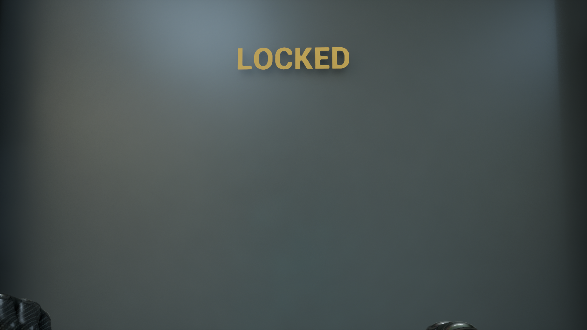
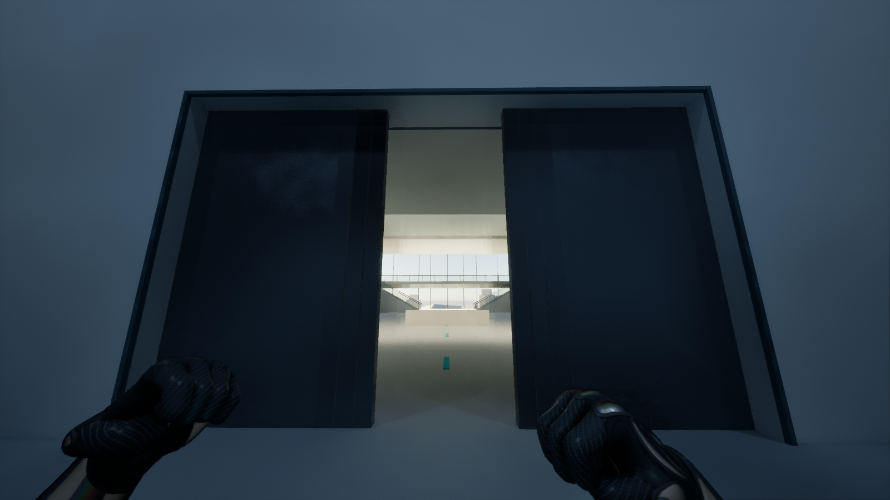
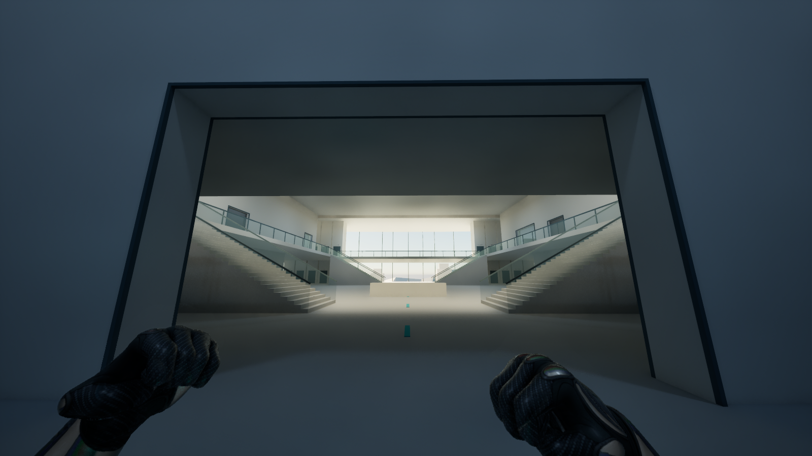

# 实验室 R17：地图、交互门与 Omen

本次修改落在原地图 `/Game/Maps/Map_LabV39`。改造前完整地图另存为 `/Game/Maps/Map_LabV39_1`。本说明是本轮交付入口；旧 `Saved/Agent/LabR17/DELIVERY_DRAFT.md` 是实施过程草稿，不代表最终状态。

## 本轮结果

- 下层西翼原红墙两处公共入口封闭，改为蓝标位置的一处 `G-WEST-MAIN`；L01 南墙增加绿色标记的门。下层 E4 小房间撤除，原位置留空。上层 E4 保留。
- 最新上下层布局已导入；训练场保持 20 × 34.7 m、8 m 净高，整备室和 2 m 双门通道保留。四座楼梯、城市外景、外立面和 Omen 原模型保留。
- 墙体、地坪按实体合并后只生成外露表面，建筑归并为 32 个网格，清理被替代的旧物体。源文件和 UE 资产均补齐 UV。原截图位置已回看，重复共面造成的地面条格闪烁已消除。
- 78 扇可调尺寸的蓝图门落位。普通门瞄准后按 **F** 开关；上锁显示 **LOCKED**；玩家占住门洞时阻止关门。C0 是 Omen 的横向双叶自动门，从两侧接近都能打开。
- Omen 使用原有六件模型。玩家进入房间后平滑注视摄像机，离开后平滑恢复原姿态；回位途中再次进入也连续过渡。

## 回来后从哪里检查

1. 打开 `Content/Maps/Map_LabV39`，Play 使用项目现有第一人称角色。普通门需要近距离瞄准后按 F；再次按 F 关闭。
2. 在 Outliner 的 `LabV39/R17/InteractiveDoors/A` 或 `B` 选门。`LabR17_Door_C0` 是 Omen 自动门；`LabR17_Door_G-WEST-MAIN` 是本轮移动后的下层西翼入口。
3. 在 Details 的 **Lab Door** 分类调整 `bLocked`、`DoorWidth`、`DoorHeight`、`OpenSeconds`。尺寸单位 cm，Actor Scale 保持 1；不要重复加门框。
4. 选中 `Characters/Omen/OmenV4` 中的 `LabV39_OmenObserver`。`FollowSpeed`、`ReturnSpeed` 控制转动响应；`RoomBounds` 控制生效范围；`TrackingEnabled` 可关闭追踪并平滑回位。

当前 **43 扇门初始锁定**，按既有 R17 阶段门表设置。任务完成后的自动解锁没有在本轮新增；后续组员持有门实例引用并设置 `bLocked` 即可。测试所有房间时可在编辑器临时关闭相应门的锁定，避免误认为 F 无效。

## 组员维护入口

| 内容 | 位置 |
|---|---|
| 建筑与 Blender 源、SceneBridge 包 | [SourceAssets/LabV39/R17](../../../SourceAssets/LabV39/R17/README.md) |
| 普通门 Blueprint | `/Game/Environment/LabR17/Blueprints/BP_LabRoomDoor` |
| Omen 自动门 Blueprint | `/Game/Environment/LabR17/Blueprints/BP_LabOmenDoor` |
| Omen 追踪 Blueprint | `/Game/Characters/Omen/Blueprints/BP_OmenObserver` |
| 可维护的蓝图生成规格与脚本 | [runtime_authoring](../../../SourceAssets/LabV39/R17/runtime_authoring/README.md) |
| 最终运行证据 | [runtime-evidence](runtime-evidence/README.md) |
| 几何修改与检查 | [geometry-evidence](geometry-evidence/README.md) |

Blueprint 继承项目已有交互体系，F 仍由 `IA_Interact` / `AC_Interaction` 处理。门的提示采用可打包的 TextRender；门动画在玩家时停时仍可播放。Omen 使用现有时间状态的 Tick DeltaSeconds。

`Plugins/LabAuthoring` 是这次补充的编辑器生成/审核工具，游戏节点不引用它。日常打开地图和游玩不需要启用；只有重建蓝图时才需要相应 UE 5.6 编辑器编译环境。最终已将其默认启用关闭，避免组员打开项目时被要求编译辅助工具。

SceneBridge 监听配置指向本项目 `SourceAssets/LabV39/R17/patch_bundle/manifest.json`，`auto_start=false`。手动同步使用 `/Game/Maps/Map_LabV39` 和 `/Game/Environment/LabV39/R17`。不要重新导入历史 `1002/LabWhitebox_v39/lab_bundle`，否则会重建已移除的旧墙。用户当前打开的 Blender 场景未被替换；新的可编辑 `.blend` 单独保存。

## 验证范围

| 验证 | 结果 |
|---|---|
| 二维门状态与路径、独立三维几何 | 通过 |
| 建筑门洞、旧门封闭、地坪、管道等 UE 碰撞查询 | 93 / 93 |
| 真实角色四座楼梯上下行 | 8 / 8 |
| 墙内高管道双向蹲行 | 2 / 2 |
| 两侧从地面开始跳四级箱台并连续穿管 | 2 / 2 |
| F 输入链、锁门反馈、防夹、自动门两侧、时停交互 | 32 / 32 |
| 全部 78 扇门全开后的真实角色胶囊净空 | 78 / 78 |
| Omen 入场、左右追踪、离开回位、中途重入及模型保持 | 21 / 21 |

F 验证注入项目真实 EnhancedInput Action 并核对键位映射，走现有角色交互链；不是物理键盘测试。全部门净空检查临时命令开门，与输入功能检查分开记录。截图已回看；最终保存、重载和辅助插件关闭检查另见最终审核记录。

最终已在辅助插件关闭后重启 UE：门 **32/32**、Omen **21/21** 再次通过。78 个门实例的尺寸、位置和锁定值与落位表一致，原 Omen 六件模型引用保持；最终保存后没有未保存的地图或内容包。见[最终保存重载审核](runtime-evidence/final_save_reload_result.json)。UE 保持打开原地图，PIE 已停止，编辑器后台节流恢复原值，临时任务轮询已注销。

训练场 S1–S7 的任务、敌人、机关、切阶段玩法和完整剧情解锁不在本次新增实现范围内。现有角色的 EmptyHands 骨骼/插槽警告以及大视野下的虚拟阴影页警告仍需另行处理；本次不把整个项目描述为零警告或已完成性能优化。

## 画面记录

普通锁门提示：

Omen 门开启中与全开：

## 几何处理依据

旧模型在上层地坪高度检测到 162 组同向共面覆盖；新建筑不再为相交实体重复生成内部顶面。处理思路参考 Unreal 的 [Boolean 工具说明](https://dev.epicgames.com/documentation/en-us/unreal-engine/boolean-tool-in-unreal-engine?application_version=5.6)，以实体合并、外露面和正确门洞解决几何问题。门的组件与平滑开合组织参考 [Unreal 开门教程](https://dev.epicgames.com/documentation/en-us/unreal-engine/opening-doors-in-unreal-engine?application_version=5.6)，实际交互仍接入本项目现有接口。
