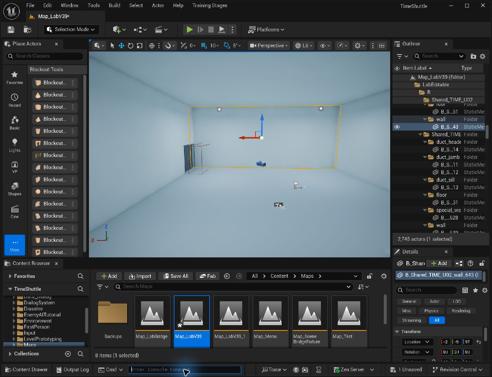

# 实验室独立构件：在 UE 中改墙、门洞和房间

更新日期：2026-10-24。工作地图为 `/Game/Maps/Map_LabV39`。

**同日外围修复更新：** 初次拆分保留了旧 R17 已有的北西外墙缺口和退役东翼高顶错误。现补入 4 段独立外墙；退役东翼移除 36 个多余高顶、将 13 个局部屋顶替换为 15 个裁剪件。当前为 **791 个独立建筑构件**，下文 821 数量表和迁移验收保留为初次迁移记录。修复源见 [EnvelopeRepair20261024](../../../SourceAssets/LabV39/Editable/EnvelopeRepair20261024/README.md)。新增构件在 `LabEditable/B/ExteriorEnvelope`；本轮修改前备份为 `/Game/Maps/Backups/Map_LabV39_PreEnvelopeFix20261024`。

原 Map_LabV39 已将跨房间的 32 个高度切片实例替换为 821 个独立建筑构件，并完成保存重载与 PIE 验证；旧 32 份网格资产不改写。1924 个非结构 Actor 的原位置、旋转、缩放、模型与材质在迁移时核对保持。原先未保存的地图内容已随恢复副本保留。

[外围修复原因、前后对照和最终验证](envelope-repair-20261024.md)。

## 找到要改的构件

- 新网格目录：`/Game/Environment/LabV39/Editable/Meshes`。
- Outliner：`LabEditable/A或B/房间编号或Shared_…/构件类型`。无明确房间归属的部分放 `Public`；主控高空间与景观平台另有 `CONTROL`、`SCENIC` 分组。
- `Shared_…` 表示关联多个房间，例如共享隔墙或公共楼板，不表示存在多份重复构件。
- 本轮恢复地图：`/Game/Maps/Backups/Map_LabV39_PreEditable20261024`。不要覆盖保存它。
- [初始源与导入清单](../../../SourceAssets/LabV39/Editable/README.md)记录构件 ID、关联房间、洞口 ID、初始变换和网格引用。

| 类型 | 数量 | 日常修改方式 |
| --- | ---: | --- |
| `wall` 普通矩形墙 | 328 | 可移动、旋转，按局部轴 Scale 改长、厚、高。 |
| `special_wall` 特殊墙 | 44 | 整体移动可以；局部改形、开孔使用 Modeling 或专用新件，不整体拉伸洞口。 |
| `scenic_wall` 景观墙 | 12 | 按特殊轮廓构件处理；改形前检查相邻平台和立面。 |
| `door_header` 门楣 | 78 | 与对应门洞一起检查；不能只改门 Blueprint。 |
| `window_header` / `window_sill` | 22 / 22 | 与窗洞、玻璃和框条配合调整。 |
| `floor` / `roof` | 188 / 107 | 先检查轮廓和孔洞；不规则件需 Modeling 改形或换专用件。 |
| 其他结构 | 20 | 景观板、风道平台、跳箱、风道侧柱等，按各自用途检查。 |
| 合计 | 821 | 对应 279 份新网格；544 个矩形实例复用两份基础盒，其余 277 个使用专用网格。 |

普通门、Omen、四座楼梯和原有非结构 Actor 仍是独立对象，不包含在这 821 个新建筑实例中。不要为修改墙洞而重新生成或替换它们。

## 修改实例，不误改共享资产

Outliner 中的 **Actor Transform** 修改该场景实例。双击 Static Mesh 后编辑顶点、布尔开孔或资产材质，会影响所有引用同一网格的实例，可能包括其他地图。

两份基础盒 `SM_LabEditable_WallUnit`、`SM_LabEditable_SlabUnit` 被大量实例共用：日常只改实例的 Transform 和材质覆盖，不编辑基础盒网格。需要局部改形时，先在 UE 中复制为新命名的专用网格，把目标实例切换到副本，再进入 Modeling。已是专用网格也应先检查引用者；不覆盖旧 R17 网格或直接改写资产文件。

普通墙 Scale 是相对基础网格的倍率，不是通用的米数输入框。先量当前世界尺寸，再将对应 Scale 乘以“新尺寸 ÷ 当前尺寸”。确认局部轴，避免负值或零值。基础盒实例的枢轴在中心，改变尺寸通常会同时移动两端；需要固定墙的一端时，应补调 Location。专用构件的枢轴可能在底部，按实际对象检查。

| 要做什么 | 操作 |
| --- | --- |
| 直墙加长或缩短 | 修改 `wall` 对应局部轴 Scale，再接齐墙端。 |
| 增加一段同类直墙 | 复制实例，立即移动到新位置并改尺寸、标签，检查原位置没有重叠副本。 |
| 改 L 形墙、局部开孔或改变不规则轮廓 | 使用专用新网格和 Modeling；保留有效碰撞与 UV。 |
| 改复杂楼板或屋顶的一条边 | 修改专用构件轮廓，不用整体 Scale 带动其他边、挑空和井洞。 |
| 只改本墙材质 | 使用组件材质覆盖或新材质实例，不改团队共用材质的全局设置。 |

## 移动墙段与调整门洞

移动墙段时先记录 Transform，在顶视或正交视图使用吸附对齐，随后检查两侧房间和墙端接缝。共享隔墙只移动一次，不在相邻房间另叠一面墙。门框、玻璃、设备和灯具不会保证自动跟随。

调整门洞按以下顺序进行：

1. 找齐洞口两侧墙段、门楣、框条及原门 Blueprint；导入清单中的 `opening_id` 可帮助对应门楣与洞口。
2. 先确定净宽、净高和底标高，再调整墙段端点、门楣下沿及框条。净宽是可通过的空隙，不是框外宽。
3. 移动原门 Blueprint，按需要修改 `DoorWidth`、`DoorHeight`，单位 cm；门 Actor Scale 保持 1。保留 `bLocked`、实例引用和门编号，不删掉旧门再随手新放一扇。
4. 检查横向双叶滑开的侧向空间。两侧分别测试 F、锁定反馈、开门净空和占门保护；C0 测试两侧靠近自动开启。

修改门 Blueprint 的尺寸不会自动切开墙洞，移动门也不会自动移动建筑门框。当前门的实例锁定参数不等于剧情自动解锁已经接好。

## 改房间时检查共享墙和 B 层楼板

- 移动共享墙会同时改变两侧房间。确认相邻房间和公共通道的宽度，不能只看本房间。
- 当前 A 地坪为 0、B 地坪为 +5.4 m、风道地坪为 +7.8 m。改标高会影响门洞、楼梯、风道和碰撞。
- **B 层楼板在许多位置同时承担 A 层顶部的实体。** 同一位置只保留对应的一份楼板，不能给上层补地面、给下层补顶时各叠一块。移除 B 板会同时影响下层上方空间。
- 上层挑空与下层地面分别判断。主控室、中央大厅和观察区的下层地面存在，不代表其上方应该铺 B 板；图纸中的下层投影也不是本层楼面。
- 扩大房间后检查新增范围是否有真实楼板、屋顶和通路；不要用整块矩形板封住楼梯口、井洞或挑空。
- 训练场当前基线为 20 × 34.7 m、8 m 净高。改边界后需重新核对阶段道具、触发体、导航和玩家可走范围，建筑移动不会自动更新教程规则。

## 避免闪面与残留碰撞

不要在现有地面或屋顶上贴同平面的新板来补色，也不要用微小偏移掩盖重叠。修改原边界或使用完整替换件，让新旧边界接合。复制后立即检查数量，避免留下原位副本。

隐藏 Actor 不等于清掉碰撞，编辑器眼睛图标也不等于运行时隐藏。最终场景不能同时保留新旧两套有效结构。检查渲染画面后，还要检查碰撞，并用实际项目角色走受影响路径；能看穿不等于能通过。

## 后续以 UE 实例为准

迁移验收后，组员在 UE 中编辑并保存的实例是当前布局权威。Blender 文件和 `modules.json` / `import_plan.json` 是本次迁移的起始源，没有自动同步，也没有将后续 UE 手工修改反向回写 Blender 的功能。不要将重建初始源当作更新当前地图。

旧 R17 SceneBridge 结构同步流程退役。禁止将 `SourceAssets/LabV39/R17/patch_bundle/manifest.json` 或更早的 `1002/LabWhitebox_v39/lab_bundle` 导回当前地图：它们可能重建旧 32 层片并覆盖手工调整。本机旧配置的 `manifest_path` 已清空，监听已停止，`auto_start=false`；恢复旧配置前必须重新划定同步范围。`keep_ue` 不能保护全部实例属性，也不能解决新旧构件拓扑差异。

如后续需要只同步家具，必须另行明确管理范围和完整对象清单，不能用原 scene ID 导入缺少其他对象的子集。保存建筑修改时，记录涉及的构件 / 洞口 ID、尺寸和原因，并按需要更新平面图。

## 恢复与验收

恢复地图为 `/Game/Maps/Backups/Map_LabV39_PreEditable20261024`。旧 32 份网格资产保持原样；不能只保留地图副本、却覆盖其引用的共享资产。回退地图也不会回退之后被改写的材质或 Blueprint，相关资产需使用自己的副本或版本记录。

每次改动后检查：墙端接合、无重复表面；两侧房间与上下层结构合理；门实际开启及通过；涉及的楼梯和风道可通行；定向保存并重新打开后实例设置仍保留。

本轮已完成：

| 验证 | 结果 |
| --- | --- |
| 样例单墙移动 1 m、长度放大 20%，其他样例构件不变 | 通过；验证后恢复 |
| 821 个导入实例的世界包围盒与源尺寸/方向 | 全部通过 |
| 独立网格闭合、正体积、32 高度截面及空间检查 | 通过；见初始源独立报告 |
| 编辑器 / PIE 建筑碰撞查询 | 108 / 108，各一轮 |
| 78 扇门全开后的真实玩家胶囊净空 | 78 / 78 |
| 门的真实 EnhancedInput 交互链 | 32 / 32 |
| Omen 入室追踪、平滑回位和模型保持 | 21 / 21 |
| 真实 CharacterMovement 四座楼梯上下 | 8 / 8 |
| 两侧四级跳箱及风道连续蹲行 | 2 / 2 |
| 修复屋顶下方 32 m 走廊行走 | 通过 |
| 保存重载、821 构件与 1924 原 Actor 变换保持 | 通过 |

门输入验证注入真实 EnhancedInput Action，并非物理键盘测试；全开净空验证临时命令开门，与输入验证分别记录。移动测试只在独立路线起点与结束恢复时传送，过程使用实际角色移动/跳跃输入。未修改角色运动参数。

独立构件选择效果：

精简证据见 [verification.json](geometry-evidence/editable-20261024/verification.json)。本次运行仍显示项目启动时已有的 `AC_DialogueManager` 编译错误：`ShowLine` 的旧 `Line` 引脚不存在；首次日志早于本次建筑修改。对话组件未改动，不将建筑验收表述为项目零编译错误。原有动画插槽及大视野虚拟阴影警告也未纳入本次修复。

技术依据：[Epic Static Mesh Actor](https://dev.epicgames.com/documentation/en-us/unreal-engine/static-mesh-actors-in-unreal-engine) 区分场景实例和网格资产；[Epic 编辑器资产 API](https://dev.epicgames.com/documentation/en-us/unreal-engine/python-api/class/EditorAssetLibrary?application_version=5.6) 用于引擎内复制及定向保存。实际验证以本项目记录为准。
