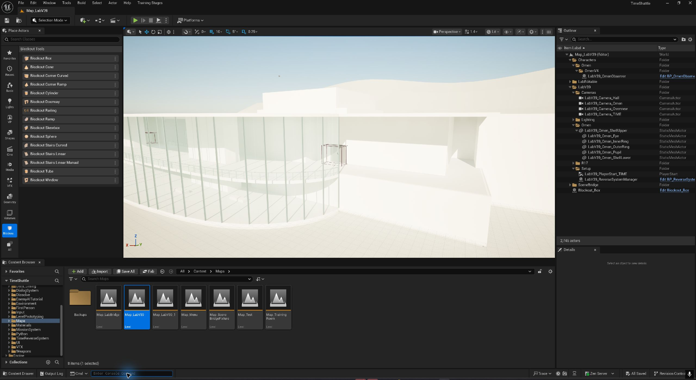
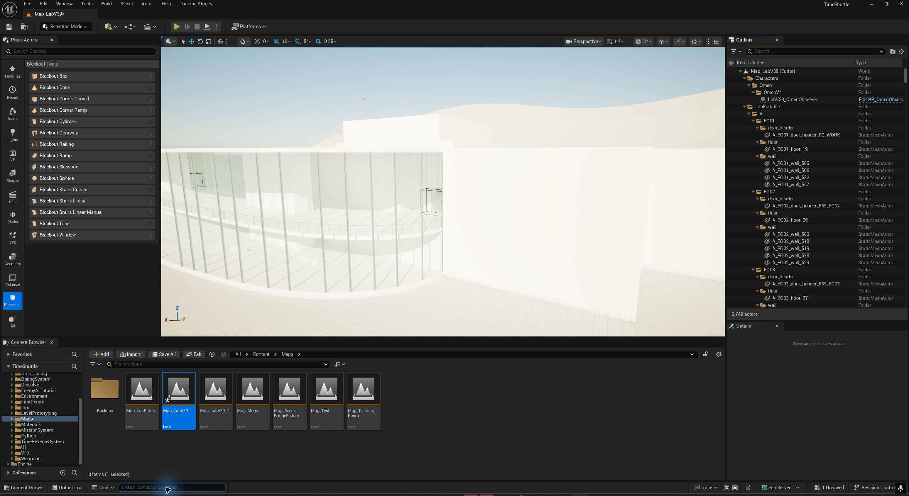
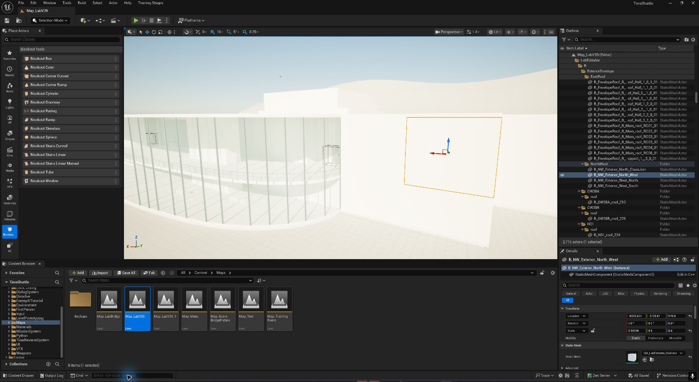
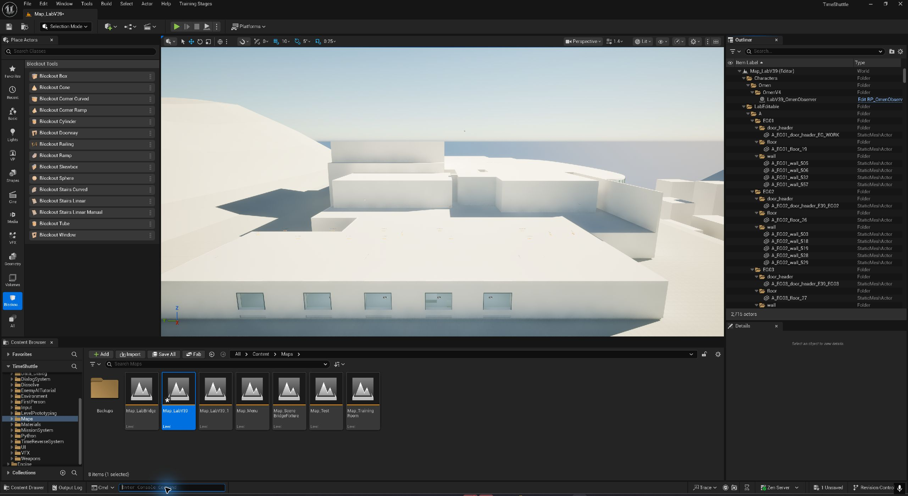

# 2026-10-24 外墙缺口修复

工作地图：`/Game/Maps/Map_LabV39`。已保存并重新加载。修复前副本：`/Game/Maps/Backups/Map_LabV39_PreEnvelopeFix20261024`。

## 原因与改动

用户截图的缺口在北西角。当前地图和拆分前 `Map_LabV39_PreEditable20261024` 按同一机位对比，均存在整段开口。源 FBX、UE 导出的网格和实例可见性均核对正常；问题是旧 R17 的新房间边界没有接齐保留外壳，初次拆分只验证了与旧结构一致，漏查了原本不完整的外立面。

补入 4 段 0.6m 厚、+5.4～14m 高的独立墙，连接上层西墙与北侧玻璃端柱。UP 北门及通往城市观景廊的路线保留。

巡视东翼发现另一个历史生成错误：已按 R8 退役为低层屋面的区域，仍残留 +14～14.45m 的高屋顶。按原退让意图移除 36 个多余屋顶实例，将 13 个局部屋顶替换为 15 个裁剪后的独立件；共去掉 3520.56㎡ 多余高顶。+5.4m 屋面、当前上层房间、交流厅、训练场、整备室、双门通道和南联络廊顶部保持。

旧网格资产未覆盖，未重新导入完整 SceneBridge 场景。当前共 2715 个 Actor，其中 791 个独立建筑构件。此次保留的 2696 个原 Actor 的位置、旋转、缩放和网格引用经重载核对一致。

## 在 UE 中找到修复对象

- `LabEditable/B/ExteriorEnvelope/NorthWest`：4 段外墙，直接调实例 Transform。
- `LabEditable/B/ExteriorEnvelope/EastRoof`：15 个裁剪屋顶构件。局部改形使用专用网格，不拉伸整块去改变一个边角。
- 新屋顶资产：`/Game/Environment/LabV39/Editable/Repairs/Envelope20261024/Meshes`。
- [可追溯增量源及重建边界](../../../SourceAssets/LabV39/Editable/EnvelopeRepair20261024/README.md)。原 821 构件源仍是迁移快照，不代表当前地图，不可重放。

## 本轮验证

| 项目 | 结果 |
| --- | --- |
| 源 FBX 与 UE 实际导出网格核查 | 共享基础盒与抽查长墙完整闭合、面朝外 |
| 新墙双向、多高度碰撞及屋顶／低屋面检查 | 编辑器 133/133；PIE 133/133 |
| 原门洞、地坪、风道、联络廊等几何回归 | 编辑器 108/108 |
| 项目角色经 UP 北门到城市观景廊往返 | 8 个路点全部到达，实际 CharacterMovement 行走 |
| 保存重载及原对象保持 | 通过；最终无未保存地图或内容包 |

本轮没有修改门 Blueprint；路线测试仅临时命令该门开启，并在结束恢复状态，不将它宣称为新增 F 输入测试。既有项目对话组件的编译问题不属于本轮修复范围。

修复前：

修复后，同机位：

可独立选择和编辑：

东翼恢复退让后的低层屋面：

详细结果：[最终状态](geometry-evidence/envelope-20261024/final_state.json)、[PIE 几何](geometry-evidence/envelope-20261024/envelope_pie.json)、[真实角色路线](geometry-evidence/envelope-20261024/walk_north_pie.json)。
