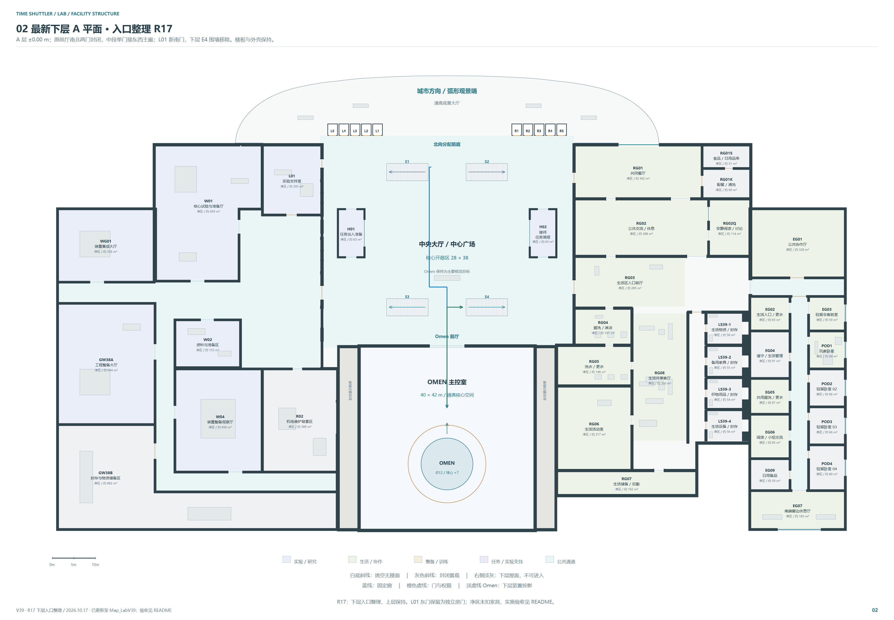
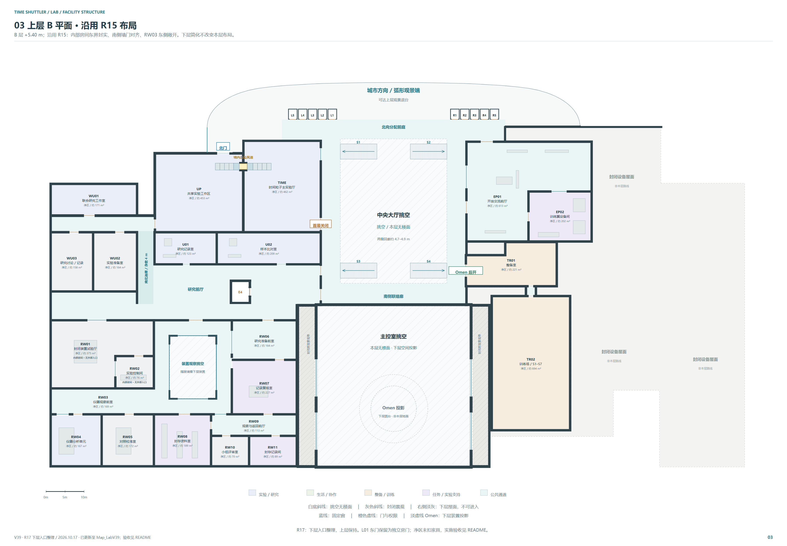
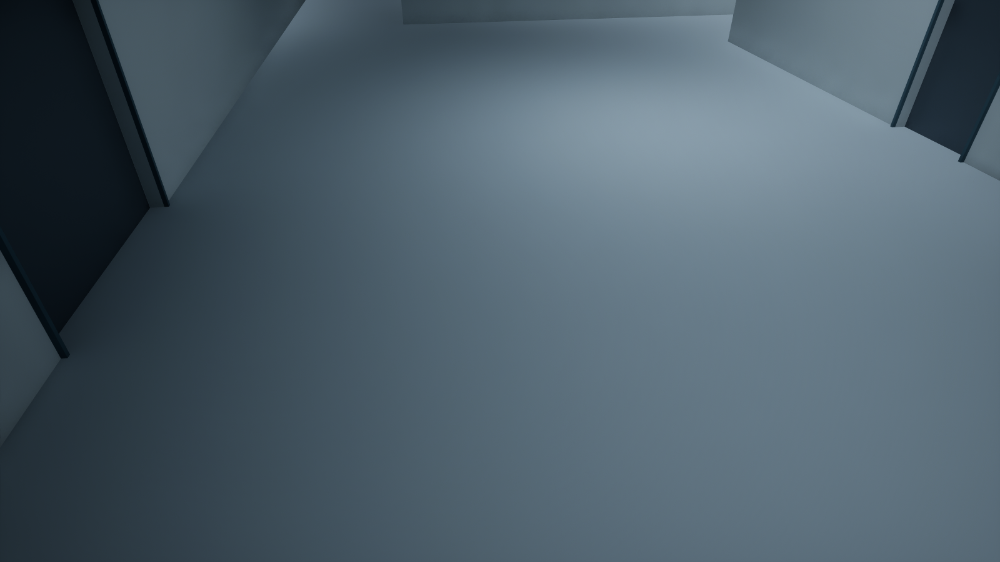
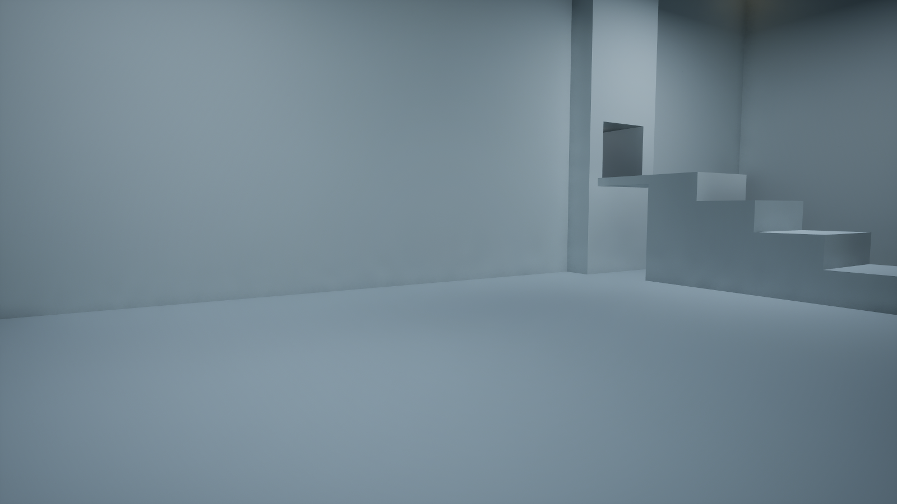
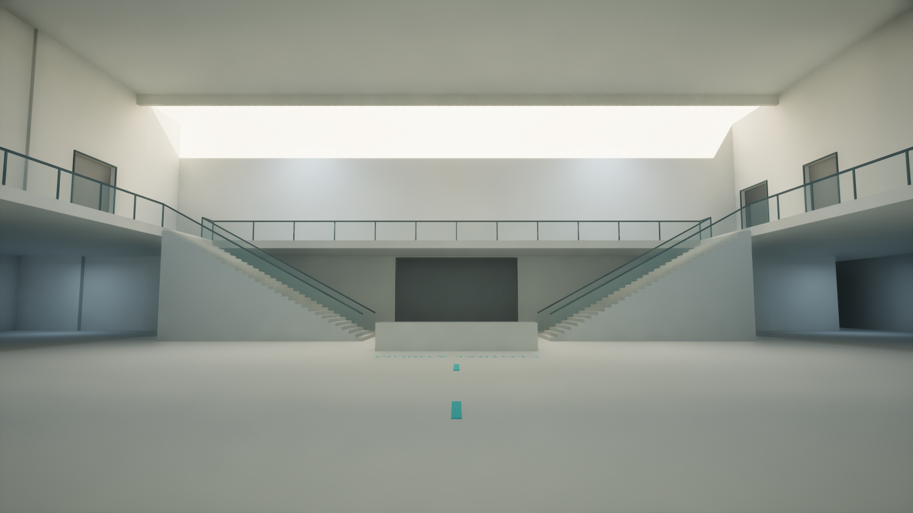

# LabV39 R17 几何、通行与交付证据

当前建筑已更新到 /Game/Maps/Map_LabV39；修改前地图备份为 /Game/Maps/Map_LabV39_1。本目录整理二维布局、三维建筑和真实角色通行证据；门与 Omen 功能见[运行证据](../runtime-evidence/README.md)，总交付入口见[LabR17](../README.md)。

本次整理仅复制已完成的检查与图像、同步图纸状态并重新打包，没有运行 UE、改动 Blueprint 或再次导入建筑。

最终地图已保存并重载；LabAuthoring 默认关闭且未加载，重载后门 32/32、Omen 21/21 再次通过。详见[最终保存与重载记录](../../../../Saved/Agent/LabR17/final_save_reload_result.json)。SceneBridge 已指向项目内 R17 包且 auto_start=false；详细配置见维护说明。

## 已落地的布局

- 下层西翼原两处公共入口封闭，单一直接入口 G-WEST-MAIN 与东西主廊对齐；L01 新增南门，原东门继续作为独立房门。两扇 L01 门均解锁时可以经该房间通行。
- 下层 E4 的围墙和门撤除，地面保持连续；上层 E4 的井体、门和原缺板保留。
- A 层地坪 0 m，B 层地坪 +5.4 m。训练室净尺寸保持 20 × 34.7 × 8 m，训练室与整备室之间保留 2 × 2 m 净通道及两扇门。
- 墙内高管道净尺寸 2.1 × 1.5 × 1.4 m；管底 +7.8 m，两侧保留平台与四级箱台。其地面墙体封闭，不能从地面绕过管道。
- 当前建筑为 32 个按高度合并的网格，完整补丁含 734 个网格对象；清理 925 个被替代的旧 Actor。原楼梯、外立面、城市背景与 Omen 美术保留。

## 几何与实机检查

| 检查范围 | 结果与原始记录 |
|---|---|
| R17 局部二维几何、门状态与半径组合 | 通过，[r17_local_check.json](qa/r17_local_check.json) |
| 导出三维边界、训练室及主控净区、管道、6 处关键门洞、层间楼板和挑空 | 通过，[independent_3d_qa.json](qa/independent_3d_qa.json) |
| UE 实际胶囊 / 线段碰撞查询 | 93 / 93，[collision_audit.json](qa/collision_audit.json) |
| 项目角色四座楼梯上下行 | 8 / 8，[stairs](qa/ue-pie-r17-stairs.json) |
| 高平台起步的双向连续蹲行 | 2 / 2，[duct](qa/ue-pie-r17-duct.json) |
| TIME / UP 两侧从地面跳四级箱台再连续穿管 | 2 / 2，[jump + duct](qa/pie_jump_duct_result.json) |
| 完整生成器的语法、UV、实施覆盖与身份保持 | 静态检查通过，[build_repeatability_static_check.json](qa/build_repeatability_static_check.json) |
| 最终图纸文字同步 | 平面 JSON 与 12 页非文字 SVG 节点 hash 均未变，[text sync](qa/r17_final_text_sync.json) |
| 原生 Draw.io 渲染 | 12 页均完成，无渲染错误且内容在页内，[render check](qa/drawio_render_check.json) |

PIE 使用项目 BP_FPCharacter，胶囊半径 48 cm、站立半高 88 cm、蹲姿半高 55 cm。楼梯与蹲行使用角色移动输入；跳台使用真实 Jump，不注入速度、不使用 LaunchCharacter、不改角色运动参数。独立路线之间允许设置测试起点，连续路线中的跳跃和穿管没有传送。

全部 78 扇动态门在全开后的胶囊净空，以及 32 项真实 EnhancedInput 交互，分别见[门净空](../runtime-evidence/all_door_fit.json)与[门功能](../runtime-evidence/door_pie_qa.json)。全开净空检查临时命令开门，不等同于 F 输入测试。以上证据不代表全地图 AI 导航、完整任务解锁、教程 S1–S7 玩法或全项目性能已经验收。

## 地面条格闪烁的处理依据

原 V39 上层 z = 5.4 m 处检测出 162 组同向共面覆盖；原 Floor_B 与其他朝上表面的重叠并集约 1133.46 ㎡，其中约 812.87 ㎡未被上方实体遮住。原始检查依据、比较范围及数值保存在独立三维 QA 中。

现建筑先按高度合并实体，只输出外露表面；导出审核中精确重复面为 0，同高度朝上面重叠为 0。A 层门楣止于本层，上层 E4 原井洞保留。UV 已补齐；截图中原条格位置已回看。

## 源文件和可重复生成

维护入口是 [SourceAssets/LabV39/R17](../../../../SourceAssets/LabV39/R17/README.md)，包含最终 .blend、SceneBridge 包、二维与三维数据、完整生成器和独立 QA。具体外部依赖、同步身份与实施覆盖见[维护说明](SOURCE_MAINTENANCE.md)。

POD1 第 042 件家具在实施时南移 1.5 m，当前 bounds 为 [85.1,-13.0,85.8,-10.1]；这是生成器记录的实施覆盖，尚未回写二维布局。该差异已验证避开门前路径，不应在组员手动更新二维位置后再重复套用。

维护版脚本读取同目录平面 JSON，仍依赖项目中的 SceneBridge addon、Shapely 与 V39 源记录。最近一次完整生成器整合仅做静态检查，没有重新运行 Blender；现有最终 .blend 与导出包保持已验证版本。

## 本次图纸交付

- [完整 12 页布局 ZIP](../../../../../output/TimeShuttler_V39_训练室接入布局_2026-10-17.zip)：27 个文件。
- [上下层 6 页平面 ZIP](../../../../../output/TimeShuttler_实验室上下层平面图_R17.zip)：15 个文件。

两包包含更新后的 README、HTML、SVG、PNG 与可编辑 Draw.io。全页“未实施 / 待实测”旧状态已同步，角色与导航的验收范围分别说明。PNG 由原生 Draw.io 生成链重新渲染；没有编辑栅格图。两包逐项与交付目录比对一致，ZIP CRC 检查通过。

平面 JSON SHA256：ae19133c9448e61e2afea88d99c67afe8946a9990ec590634bba19bcdf23a2d9。三维建筑 SHA256：35a35a39cd5bd9e4d6c8ed22a6c453b7eb73c390577cdda3968c24c7c053d37d。

本目录文件来源、ZIP 与源文件 hash 见 [delivery_manifest.json](delivery_manifest.json)。旧 ZIP 保留于工作区 tmp/v39-training-direct/superseded-r17-pre-final-docs/；R16 备份保持原位置。没有复制大型缓存或 helper 编译目录。
