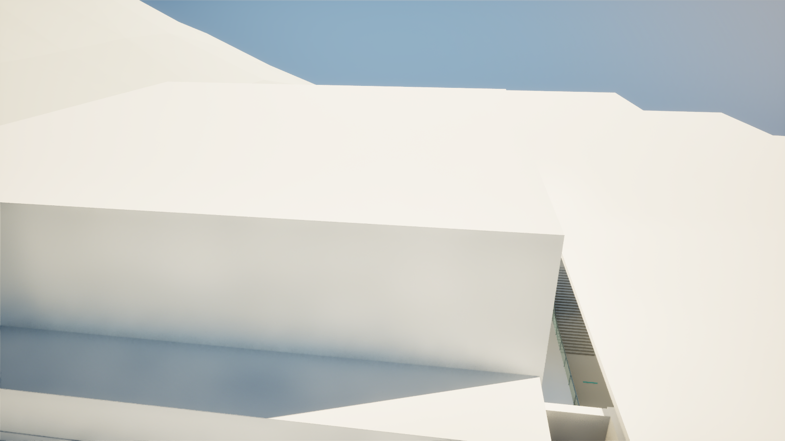
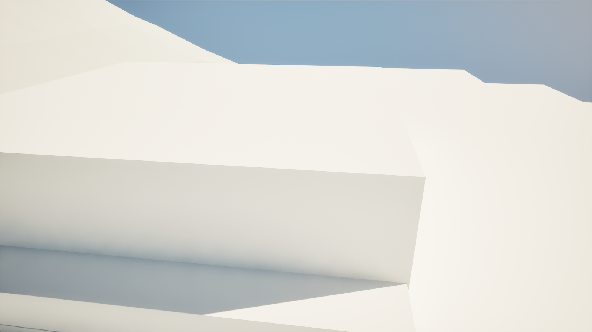

# R17 屋顶缺口修复 · 2026-10-24

已修复原地图 `/Game/Maps/Map_LabV39` 中，主控室前方上层南侧联络廊的漏顶。修改两块相邻建筑网格，保持当前房间布局与实例位置。

## 原因与修改

主控室屋顶高于普通屋顶。原生成器用 `control.buffer(5.3)` 整块扣除普通屋顶，预留范围超过了主控室和景观结构的真实覆盖，造成联络廊顶部缺失。

`SourceAssets/LabV39/R17/prepare_architecture.py` 现在按主控室真实外包、景观平台和景观外墙范围扣除。仍通过高度分层实体合并生成外露面，没有额外叠放共面补丁。

- 仅 `SM_LabR17_Structure_25`、`SM_LabR17_Structure_26` 改变；734个导出对象中其他732个未变。
- 屋顶新增实体的水平面积为231.868㎡，高度14–14.45m。对应B层原198.9188685㎡漏顶归零，两者统计范围不同。
- 原楼板、中央挑空、主控室上方高空间、E4井洞、四部楼梯、墙内风道和训练场8m净高保持。
- Blender维护源、生成器、两份FBX与SceneBridge manifest已同步。当前manifest为revision3，场景与物体ID、变换保持。

## 验证

- 独立网格复核：屋顶覆盖、共面、楼板与必要开口检查通过；变化仅在14–14.45m屋顶高度。
- UE编辑器19项碰撞检查通过；PIE中相同19项检查通过，包括屋顶底面高度、走廊站立胶囊、地面、挑空、风道与训练场净高。
- 使用实际 `BP_FPCharacter` 的CharacterMovement输入，在新屋顶下方沿走廊行走约32m并成功到达。仅测试起点设置与测试后恢复使用位置重置，没有改动移动参数。
- 相同外部与室内视角对比，原开口已经封闭。没有据此宣称整个项目不存在渲染警告或完成全地图性能验收。
- 没有修改Blueprint逻辑；本轮无需重新编译门或Omen蓝图。PIE退出，临时任务轮询停止，恢复原编辑器视角；定向保存后无脏地图或内容包。

| 外部视角：修复前 | 外部视角：修复后 |
|---|---|
|  |  |

| 走廊仰视：修复前 | 走廊仰视：修复后 |
|---|---|
|  |  |

[结构化验收摘要](geometry-evidence/roof-20261024/verification.json)。本机完整过程记录位于 `Saved/Agent/LabRoofFix20261024/`。

## 恢复点

本次修改前的两份StaticMesh已通过UE复制并保存：

- `/Game/Environment/LabV39/R17/Backups/Roof20261024/SM_LabRoof_Structure25_Before`
- `/Game/Environment/LabV39/R17/Backups/Roof20261024/SM_LabRoof_Structure26_Before`

需要回退时，在UE中将这两份备份分别赋给同编号的两个Actor，并定向保存地图。维护源的修复前快照在 `Saved/Agent/LabRoofFix20261024/source_before/`；回退后也应同步维护源，避免下一次SceneBridge同步重新应用当前修复。不要直接改写 `.uasset` 或 `.umap` 二进制。

本轮没有覆盖原 `Map_LabV39_1`。新恢复点针对本次两份屋顶资产，原地图备份不替代本次资产恢复副本。
