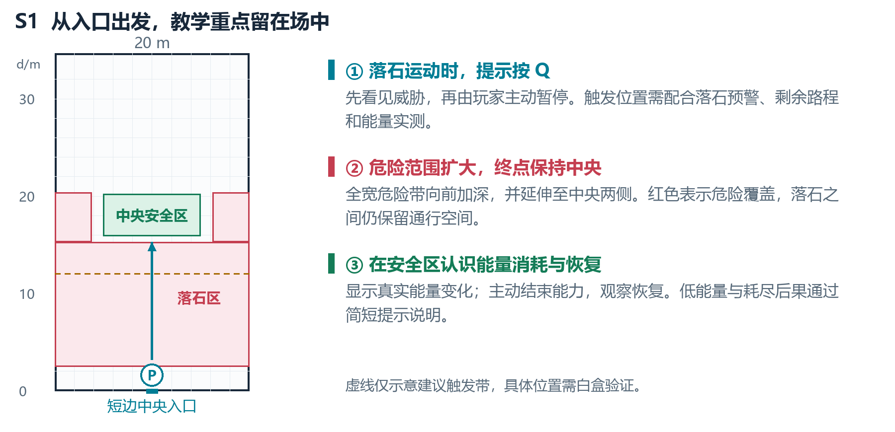
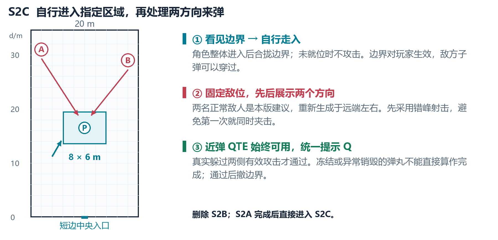
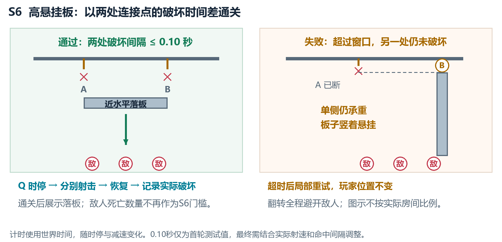
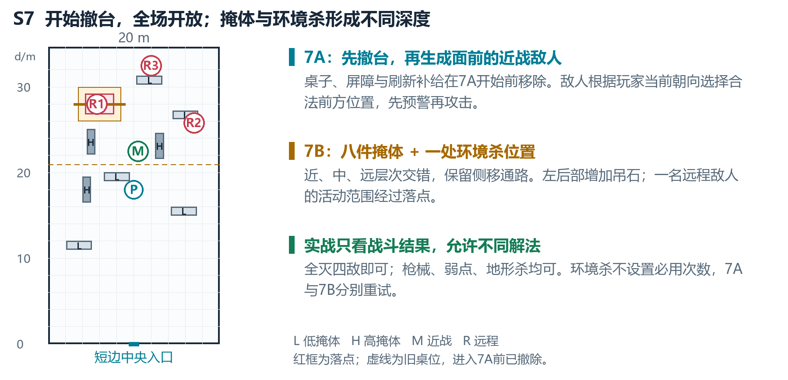

# Time Shuttler 教程关策划案

2026年10月15日 R4 设计方案 · S6判定更新

本版用于下一轮训练室教程改造：从主动时停与能量认知，逐步进入躲弹、基础枪械、移动弱点、环境击杀，再完成综合实战。本文是策划交接，不代表UE已经完成修改。

主动时停与近弹QTE统一使用Q；3B暂编为移动靶基础射击。S6采用本轮提出的高悬挂板，并按两连接点实际破坏的时间差通关。0.10世界秒为首轮测试建议，不是已经验证的最终数值。

## 本版替换的旧规则

| 部分 | R4设计方向 |
| --- | --- |
| S1 | 落石开始下落时提示Q，由玩家主动开启时停；增加能量机制教学。 |
| S2 | 删除2B，保留2A并重做2C；2C限制在指定区域，使用固定站位正常敌人。 |
| S3A与3B | 3A普通命中可杀敌；3B暂定移动靶，不再重复拾取与换弹门槛。 |
| S4 | 正常人形敌人左右移动，只接受有效弱点伤害。 |
| S5 | 普通射击也能破坏连接点；三个敌人均被吊锤杀死即通过。 |
| S6 | 高挂板两侧近同步破坏；以两连接点破坏时间差通关，不再检查三敌死亡。 |
| S7 | 开始就撤武器台；7A敌人在玩家面前生成；7B增加环境杀点、调整敌位和掩体。 |

## 主线与贯穿规则

S1 → S2A → S2C → S3A → S3B → S4 → S5 → S6 → S7A → S7B → 完成。

近弹QTE功能全游戏保持启用，临近命中时提示Q。所有普通换场保持玩家位置和朝向，通过融化替换场内道具。S2C的指定区域由玩家自行进入；限制区域不等于阶段传送点。

# 01 S1 主动时停与能量教学

## 玩家体验与场景

玩家从短边中央入口向场内走。落石先出现下落预兆并开始运动，再提示“按Q暂停时间”；玩家成功启动能力后，穿过危险区，到达中央安全区。取消旧版自动代触发与强制锁定时停。

沿用20 × 34.7 m训练室。危险带建议覆盖全宽、纵深d=2.5至15.3 m，并向中央两侧延伸；安全区仍在场中。触发点优先布在危险带后半段；触发前只预警，不让提前落石伤害截断教学。按Q后的路程应适配正常能量窗口，不偷偷暂停耗能。

## 能量教学与完成条件

第一次使用时突出能量条，展示开启消耗、结束后恢复；说明能量低时控制减弱、耗尽会退出。当前资料中的100至70完整时停、低于70减速、0退出仅作为接入时需核对的参数，不将阈值写死在提示中。

建议通过条件：本轮玩家成功主动时停、全身进入中央安全区、落石结果结算，以及实际观察到能量下降后重新增长。进入安全区后提示再按Q结束能力；低能量与耗尽机制用简短说明补充，不强迫首轮耗空并等待回满。

# 02 S2A与S2C 躲弹及区域限制

## 2A 单方向建立规则

用正常敌人外观替换占位符，固定站位，允许瞄准、开火和时间反馈，关闭巡逻追击。建议保留一名敌人一发的有限轮次：玩家真实躲过有效攻击且未受伤后完成。近弹时显示Q提示，不因使用提示扣除通过资格。

## 2C 区域内处理两方向威胁

删除2B后由2A直接进入2C。建议限制区为x=-4至4、d=13.5至19.5 m；用可见的训练边界限制玩家，保留侧移和躲弹空间。玩家整体进入后，记录区内合法检查点，再合拢边界并启动敌人；未进入时不攻击，不传送或推回玩家。重试回到本段区内检查点。

敌人数本轮建议为两名，位置参考(-8,31)、(8,29)，清理2A后重新生成；这是2C的新建议，并非继承旧2B定案。两敌不可移动，首次攻击错峰。建议两侧各实际发出一发有效威胁，均被躲过且未受伤后完成；随后清弹、撤边界，再生成S3武器台。

在瞄准锁定时记录有效威胁，允许预兆期闪避，弹丸经过危险窗口才结算。未发射、冻结、异常销毁或寿命到期不能直接通关；异常丢失则重开本轮，2C两侧一起重开。受伤也重试当前小段。

# 03 S3A S3B与S4 射击能力递进

| 阶段 | 目标与受伤规则 | 建议通过条件 |
| --- | --- | --- |
| S3A 基础操作 | 四名固定人形训练敌人，普通身体命中有效，无强制弱点。 | 分别完成拾枪、拾弹、有效手动换弹；四名敌人被实际击败。 |
| S3B 移动跟枪 | 暂定两名左右移动的人形训练目标，普通命中有效；不新增弱点要求。 | 两名移动目标全部被实际击败；不再次要求拾枪、拾弹或换弹。 |
| S4 移动弱点 | 三名人形训练敌人依次左右移动，开启强制弱点伤害；身体命中无效。 | 三名目标均通过有效弱点伤害死亡；第一名引导Q辅助瞄准并观察释放结果。 |

## 为什么拆成这三段

3A解决枪械操作，3B解决跟随移动目标瞄准，S4再加入精确弱点要求。三段都使用与实际战斗一致的人形模型，但训练行为分别配置；更换模型不等于启用完整敌方追击和攻击AI。

3B为依据本次“会位移的靶子”说明作出的暂定编排；两名数量不是已确认旧设计。S4第一名明确演示时停辅助，但不能用“按过Q”替代真实弱点命中；正式评分以该敌人的有效伤害与死亡结果为准。

## 3A无法进入3B的预期处理

这是用户报告的待复现问题，目前没有可靠的3A与3B实现定义或定位证据。不能把条件缺失、编号错误或蓝图连接错误直接当作已知原因。

预期行为：3A完成全部操作与四敌击杀后，只提交一次完成事件；保留枪、弹和已完成操作记录，清理本段残留并进入3B。3B建立自己的目标名单与死亡计数，不继承3A的目标数，也不重新等待一次拾枪事件。

实施验收需记录：当前阶段、拾取与换弹标记、存活目标名单、完成事件次数、下一阶段入口是否执行。分别测试先换弹后射击、重复拾弹、提前清靶和重试后完成，先复现再修复，不在策划中宣称bug已解决。

## 武器台与补给

S3A至S6持续保留全宽武器台、玩家阻挡和弹药刷新。持续补弹进入备用弹药，仍需手动换弹；没有翻越或绕到目标一侧的通道。进入S7时才一次性撤除。

# 04 S5 环境击杀与S6同步破坏

## S5 只建立环境因果关系

保留一处吊石或吊锤、可破坏连接点及下方三名训练敌人。提示“射击连接点，让吊锤消灭下方敌人”。普通射击和时间弹都能对连接点造成伤害，不再检查玩家是否开启时停。

通关条件严格对应本轮要求：三名指定敌人全部由本段吊锤造成实际死亡。连接点被打断、重物开始下落或清理时敌人消失，都不能提前通关；若玩家在同一帧死亡，先处理失败。

建议本段训练敌人只接受吊锤的致命伤害，避免误枪杀后永远无法满足环境死亡条件；若决定保留枪杀，则误杀应明确结束本轮并局部重试。失手后重建装置及本轮三个目标，清空本轮判定，保持玩家位置和补给。

## S6的新教学目标

利用时停暂存两发子弹，把先后完成的两次射击安排成接近同时的破坏。取消等待三名移动敌人同步进入落点的要求，也不再采用固定托架或短时开关方案。

## 场景与玩家操作

武器台对侧高挂一块长板，左右各一组独立可破坏挂架；两处都能从桌后瞄准。板下三名静止敌人沿左右分布，只负责展示环境击杀结果。单侧断开时，另一侧继续承重，板子翻转后竖着悬挂；两侧近同步断开时，板子以较大水平覆盖落下。

玩家按Q进入完整时停，分别射击左右连接点，再结束时停，让暂存子弹释放并击破两处。单侧翻转的整个扫掠范围都应高于敌人，板子的两侧挂架需限制无规律扭转。高度、板长及摆位须在现有约8米净高房间内验证。

## 本轮确定的通关方向

唯一教学完成条件：本轮两个不同连接点的实际破坏时间差不超过设定窗口。建议首次测试取0.10世界秒，并做成可调参数。三敌死亡、板子落地和是否保持完全水平都不再参与通关判定；它们用于展示动作后果。

S5仍要求三名指定敌人实际死于吊锤；S6改为检查同步破坏。不要把S5的击杀计数继续接到S6完成逻辑。

# 05 S6 计时规则与失败恢复

## 实际破坏计时

第一处首次有效破坏记t1，另一处首次有效破坏记t2；两次使用同一世界时钟。满足t2－t1≤0.10秒即锁定成功，同帧记0，等于阈值也通过。记录破坏而非开枪、命中未破坏或清理销毁；重复及旧轮事件不计。

计时随世界的时停与减速变化；按当前实际倍率推进。允许先破坏一侧，再按Q保留窗口补另一侧。先处理同帧有效破坏，再检查超时，避免回调顺序误判；不额外检查Q次数。

## 成功与失败反馈

成功后先展示落板，再推进S7A。敌人没死或板子卡住不能撤销成功；演出异常时安全结束演出并继续，避免等待物理结果卡关。

超过窗口且另一侧未破坏则锁定本轮失败，迟到命中不能补过。展示倾斜反馈后清理旧弹，重建板子、两连接点及演示敌；不累计上轮破坏，保留玩家位置、朝向、装备和桌面补给。

0.10秒尚未验证。需对照普通最快连射、时间弹释放后的破坏间隔及不同帧率调整。若普通射击实际满足窗口，也应按规则通过；需要时间能力才可过的目标，应通过参数实测达成。

# 06 S7 撤台后的近战与综合战场

## 进入7A之前先撤除武器台

完成S6后停止桌面刷新，清理未拾取补给，融化撤去武器台和玩家阻挡；保留玩家已持有的枪械与弹药。此时就开放全场，不能再等到7B才撤台。

7A以玩家当前水平视线为参考，在前方约3.5至5.5 m的合法空地生成一名近战敌人。先给生成预兆，完整出现后才攻击。贴墙朝墙等无合法点时，提示玩家自行面向场内，等待而不传送、不强转镜头，也不改在背后生成。

## 7B 加入地形杀与错落掩体

建议沿用一近战三远程，布置八件高低掩体，在左后部增加一处吊石装置；调整左侧高掩体与远端低掩体，保留通路。一名远程敌人的活动范围经过落点，为玩家提供真实环境击杀机会；另两名远程保持不同深度。

新掩体和装置占位需避开玩家，生成完成后再启动攻击，可提供一次准备确认。通关只要求四敌死亡且玩家存活，允许枪械、弱点、环境或混合解法，不要求每个人都用一次地形杀。7A死亡只重试7A，7B死亡只重试7B。

# 07 统一阶段判定与切换顺序

| 阶段 | 主要完成依据 | 下一步 |
| --- | --- | --- |
| S1 | 主动时停、中央安全、落石结算、能量消耗和恢复反馈 | S2A |
| S2A | 有效单发攻击已躲过，本轮未受伤 | 撤旧敌，准备2C |
| S2C | 区域内完成两方向有效躲避，本轮未受伤 | 撤边界，再生成武器台 |
| S3A | 拾枪、拾弹、有效换弹、四敌死亡 | 保留装备，进入3B |
| S3B | 移动目标全部被有效击败 | 换为强制弱点目标 |
| S4 | 三名移动敌人全部被有效弱点伤害击败 | S5 |
| S5 | 三名指定敌人全部死于吊锤 | S6同步破坏 |
| S6 | 两连接点实际破坏时间差≤阈值；初测0.10世界秒 | 撤台，进入7A |
| S7A与7B | 各自敌人全部死亡，玩家存活 | 7A接7B；7B解锁出口 |

## 普通换场

目标满足 → 结算必要结果与同帧受伤 → 一次性确认完成 → 展示结果 → 停止旧行为并清理 → 检查新物件占位 → 融化替换 → 激活下一段。成功记录与开始下一段应分开，不在最后一枪命中时立即刷新新敌人。

只等待参与本段判定的必要结果：S5须结算环境击杀，S6在两处破坏满足窗口时即锁定成功，后续落板是演出。成功后停止并清理无关弹丸，包括冻结子弹，不等其寿命耗尽。融化、回收及旧阶段迟到事件不计入新段。

## 位置和重试

普通切场不移动或旋转玩家。新场景准备妥当后才记录该段检查点，避开新道具；2C例外：玩家自行入区后再记录区内检查点和启用边界。玩家死亡或主动重试可沿用本小段检查点，清理旧威胁并恢复本段所需状态；整套重置与普通推进使用不同流程。

# 08 实施边界与验收重点

## 按键统一与当前实现差异

目标设计统一Q。现有本地记录仍是T主动时停、Q回溯，因此实施时必须协调输入映射、QTE、HUD、教学对白与按键提示；同一次Q只处理一次能力操作，不能主动输入和QTE各执行一次，导致刚开启就关闭。回溯的新按键本轮未决定，不应擅自占用另一个键。

## 必须验证的行为

| 检查 | 可观察结果 |
| --- | --- |
| S1与能量 | 落石正在下落时玩家主动Q停住；安全区无误伤；能量真实消耗与恢复，提示与实际阈值一致。 |
| 2C限制 | 玩家自行进入后才合拢；边界挡玩家不挡子弹；区域外不先开火，完成后边界确实撤去。 |
| 3A至3B | 完成事件只发生一次；装备保留；3B不等待重复拾枪，目标计数不串段；卡关原因另行复现。 |
| 模型和弱点 | 3A/3B普通命中有效；S4身体无效、弱点有效且左右运动；替换模型后碰撞和伤害接收正常。 |
| S5与S6 | S5三敌死于吊锤；S6只看两连接点破坏间隔。验证同帧、阈值边界、重复事件、超时重试及演出异常。 |
| S7与换场 | 7A前已撤桌和阻挡；敌人在可见前方安全生成；地形杀可用，掩体不封路，旧威胁不跨段。 |

## 仍需确认或实测的项目

3B正式段名与目标数暂按移动靶编排，其卡关尚未定位。S6需验证悬挂净空、翻转表现、两发时间弹的稳定破坏及0.10秒窗口；阈值不是最终值。2C人数、区域尺寸和S7具体摆位仍为建议。

## 版本依据

R4以本轮用户提出的高悬挂板和“两连接点破坏时间差通关”为S6依据，替换R3托架、三敌死亡门槛等旧规则。其余沿用R3；空间参考SourceAssets/TrainingStages，实现对照Docs/Implementation。未修改UE或验证新机关。
