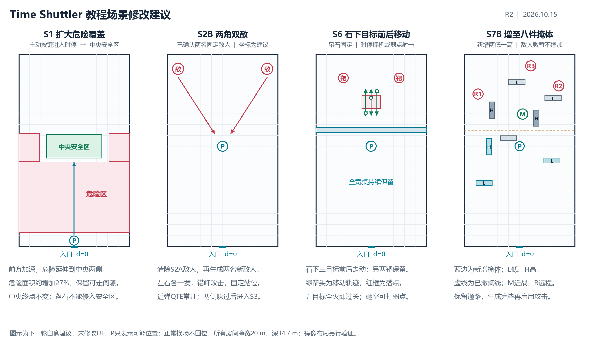

> **历史版本 R2：请使用最新 [R4 策划案](training-room-tutorial-r4-2026-10-15.md)。** 本文的保留2B、删除2C、S6及撤台时机等内容不再代表最新需求。

# Time Shuttler 教程优化与阶段判定

版本：2026-10-15 R2。用途：下一轮教程修改的策划依据。

**状态：用户已确认本轮修改方向及S2B双敌配置；下文通过判定、具体摆位与参数为实施建议。本文件不代表UE资产已经修改，也不沿用旧版验收结果为新方案背书。**

## 一 用户已经确定的修改

| 部分 | 本轮确定的设计 |
| --- | --- |
| 全局近弹QTE | 整个游戏中，子弹即将命中时的QTE提示功能始终存在；S2B及后续阶段不能将其关闭。提示不等于自动替玩家开启时停。 |
| S1 | 提示按键，由玩家主动进入时停，再走到安全区；危险区域扩大。中央完成区与入口到场中的方向保留。 |
| S2A | 替换为正常敌人模型，保持固定站位，不移动。 |
| S2B | 清掉上一轮敌人，重新生成两名正常敌人；玩家对面的左右角落附近各一名，保持固定站位。 |
| S2C | 删除，S2B直接接S3。 |
| S3 | 沿用现有拾枪、拾弹、换弹和基础射击教学。 |
| S4 | 本轮没有提出修改，先沿用移动弱点练习。 |
| S5 | 只教破坏环境造成环境击杀；不再强制时停、时间弹或手动恢复时间。 |
| S6 | 吊石下方敌人前后移动；玩家可用时停选择破坏装置的时机，也可用时停射击弱点。 |
| S7 | 增加掩体，保留错落层次。 |

继续保留：独立训练室、同图融化换场、正常切场不移动或旋转玩家、无固定回位点；S3至S7A封闭补给桌持续存在，S7B撤桌开放全场。

### 全局QTE的准确含义

“一直存在”指功能始终启用，满足即将命中的威胁条件时显示提示，不是把提示文字永远挂在屏幕上。S1的落石按键提示应与该提示使用一致的交互语言，但落石威胁需要自己的触发，不假设子弹检测会自动识别落石。

系统自带的近弹QTE不能被当作玩家请求额外帮助，也不能因为出现QTE就判为不合格。H等额外提示和教学说明可以另记，但必须与常规QTE区分。

## 二 新流程和每段通过条件

主线：**S1 → S2A → S2B → S3 → S4 → S5 → S6 → S7A → S7B → 出口。**

下表是建议采用的新判定。原则是检查实际发生的行为和结果；不以按键次数、等待时长或物件被清理代替完成。

| 阶段 | 建议通过条件 | 何时可以开始下一段 |
| --- | --- | --- |
| S1 主动时停 | 本段中玩家按提示成功进入时停，作用于本轮落石威胁；随后整个角色胶囊进入中央安全区。只按T但能力没有启动不算。 | 提示恢复时间，等世界恢复、落石落地和到达反馈完成，再进入S2A。恢复时间可以由玩家操作或能力自然结束，不额外检查“必须再按一次T”。 |
| S2A 单方向躲弹 | 固定敌人实际发出本轮一发有效威胁；玩家避开这发攻击，危险窗口结束且本轮未受伤。允许正常侧移或时停辅助，QTE始终可用。 | 先停止旧敌人攻击，确认本轮判定，再清理其弹丸和敌人；两角新敌人生成完成、出现提示后才启动S2B。 |
| S2B 两方向躲弹 | 两名新敌人各发一发，本轮两次有效攻击均已成功躲过，且玩家未受伤。建议错开首发，先让玩家看清两个方向。 | 完成两侧判定后停止射击，清理本轮威胁与敌人，直接生成S3桌和补给；不再进入S2C。 |
| S3 枪械基础 | 分别完成实际拾枪、拾弹和有效手动换弹，并击倒四个目标。保留现有判据。 | 等最后命中及死亡反馈完成后换靶；共享桌、屏障与弹药槽不断开。 |
| S4 移动弱点 | 依次解决三个弱点靶；沿用首靶有效时间弹命中与手动恢复要求，后两靶按原规则完成。 | 第三靶死亡结算后生成S5装置；不因靶的融化或删除增加击杀。 |
| S5 环境击杀 | 玩家用普通射击或时间弹破坏装置，落石实际造成三名教学目标的环境死亡。不存在强制时间状态或T键操作条件。 | 落石冲击、死亡和结果反馈完成后进入S6；连接点刚断或岩石刚开始下落不能直接跳段。 |
| S6 自由组合 | 五个目标全部解决即可；环境、弱点枪击或混合方式都有效。不要求两种方式都用，也不设环境击杀配额。 | 剩余弹丸与落石威胁处理完成后出现完成选择；沿用Enter继续至S7A。原移动吊石选做若保留，仍可O进入、随时Enter离开，不参与主线通关。 |
| S7A 近战预览 | 玩家一侧的一名真实近战敌人死亡，玩家存活。 | 结算残留近战攻击后停补弹，撤桌、屏障及未拾取弹药，保留玩家已携带装备；布置S7B战场。 |
| S7B 综合实战 | 一近战、三远程全部死亡，玩家存活；无指定路线、掩体或击杀方式要求。 | 结算剩余攻击、停止训练威胁后显示完成并解锁出口。 |

### S2 怎样判断玩家确实躲过

建议保留有限攻击轮次：S2A一名敌人一发，S2B两名敌人各一发。本轮结束前不无限补射。若要增加练习次数，显式开始新轮，不悄悄改变计数目标。

1. **先确认攻击有效。** 在瞄准锁定时确认预计轨迹会穿过玩家的受击体积，固定这一发的瞄准点，给出预兆后实际生成弹丸。玩家可以在预兆期提前侧移，不能因为开火时已经离开原位置而判成敌人射偏。生成失败、弹道与锁定不符或枪口被近处障碍挡住，属于无效尝试；先清理该无效弹丸，再重新准备，不额外堆积子弹。
2. **再确认危险窗口已经过去。** 该弹丸实际飞过锁定时原本会击中玩家的区域，而玩家已离开；或者玩家移动到遮挡后，该威胁实际被阻断。仅移动一定距离不能证明躲弹。
3. **最后核对没有受伤。** 同一帧先结算受伤，再提交成功；S2A和S2B受伤均重试本小段。
4. 冻住的子弹仍未完成考验，除非后来恢复运动并完成有效躲避。仅寿命耗尽、被换场清理、被重试销毁，均不记为躲过。弹丸异常消失应重开本轮攻击，不能让关卡永远等不存在的威胁。

S2B建议两发有短暂错峰；射击时序服从世界时间，不能在完整时停中偷偷推进第二名敌人的开火。QTE对两个方向始终可用，减少的是冗长操作教学，不是关闭系统提示。S2的任务是躲弹，不要求杀掉这两名敌人。

## 三 场景修改建议

以下图和坐标用于白盒迭代，均未在UE中实施。坐标单位米：入口中心为`(x=0,d=0)`，d朝房间深处；房间沿用净宽20、深34.7、高8。中央安全区继续保留。

### S1 扩大覆盖范围 保留中央终点

现有落石带已横跨20米场宽，因此重点扩大纵深，并增加中央安全区两侧的威胁，不继续横向扩出墙体。

| 区域 | 横向x范围 | 纵向d范围 |
| --- | --- | --- |
| 建议主危险带 | -10至10 | 2.5至15.3 |
| 建议左侧延伸 | -10至-6.2 | 15.3至20.4 |
| 建议右侧延伸 | 6.2至10 | 15.3至20.4 |
| 保留中央安全区 | -5至5 | 15.904至20.242 |

总危险面积约295平方米，比旧布景约231平方米增加约27%。入口留下2.5米预备空间，中央安全区两侧各留1.2米横向缓冲。危险范围扩大不等于把石块挤得更密；必须保留真实可穿行间隙，且所有落石的碰撞和伤害范围都不能侵入安全区。

**主动时停带来的新检查：** 旧S1的自动锁定时停不能保留为通关替代。落石应先有可读预兆，提示后等玩家真实启动能力，不在读字时立即击中。触发线和落点应让剩余穿行路程适配现有能量窗口；先调整触发位置与路线，再做玩家试玩，不未经决定就延长全游戏时停或停止耗能。当前切片的满能量完整时停窗口约3现实秒，这一值须在接入时重新核对。

进入安全区后突出“恢复时间”和能量开始恢复的反馈。删除S2C后，不再要求玩家故意耗尽能量再等到70%；能量提示并入S1首次使用及S4首次低能量提醒。

### S2 正常敌人外观 固定站位

S2A可沿用正前方位置，替换成正式敌人的外观与动作表现。S2B在清掉S2A敌人后重新生成两名；建议基准位置为`(-8,32)`与`(8,32)`，距侧墙2米、远墙2.7米，避免贴墙和出墙。

“不移动”约束位移与巡逻，不妨碍朝向玩家、瞄准、开火和受时间状态影响的动画。启用敌人时必须禁用巡逻、追击与自动找掩体，仅开放本段规定攻击；不能换成正常敌人模型后让完整战斗AI自行启动。玩家在另一侧时按当前朝向关系选择对应远侧角落；图中只画基准朝向。

### S5 简化为环境因果教学

提示应表达“射击可破坏部位，让落石砸中下方目标”，无需先讲时停。当前装置可以继续使用连接点，但视觉高亮、文字与真正可受击部位必须一致，不能让提示叫玩家打石头而只有一个难辨认的连接点有效。

建议继续使用静止成组目标，让这一段只增加环境击杀一个概念。三个专用教学靶沿用本段抗直接枪击的设置，并明确反馈无效命中；这个限制不继承到S6。若落石没有完成全部击杀，待其落地且无危险后局部重建装置，保留已完成目标和玩家位置，继续解决剩余目标；不要求整段重新跑。

### S6 把时机选择交还玩家

保留五个目标：原吊石下三个目标改为纵向往返，另外两个移动弱点目标先沿用。吊石固定，移动的是下方敌人；不要把本轮要求误做成只让石头自己移动。

- 吊石中心建议沿用`(0,26.025)`；落点范围约`x=-1.7至1.7，d=24.825至27.225`。
- 三条纵向轨迹设在`x=-1、0、1`，各自沿`d=23.6至28.4`往返，确实进入又离开落点，不是始终待在石头下。
- 速度先试1.0至1.2米/秒，各目标错开相位；具体值为白盒参数。移动、落石和弹丸均服从同一套时间状态。
- 玩家可等敌人进入落点，时停后破坏装置，再恢复时间；也可用时停瞄准弱点，或直接进行有效弱点射击。通过只看目标是否解决。
- **时停不等于锁定落石未来一定命中。** 时间恢复后敌人也可能继续走动，应结合落石高度、下落时间和目标速度形成可读命中窗口，避免偷偷冻结目标到石头落地来保证答案。
- 砸空后仍保留枪械解法。落地石块若挡住往返路线，应提供可走的备用短路线，或在无危险、无玩家占位后清理残骸。不能让敌人永远卡住或失去弱点可见性。

“至少按一次T”“必须获得一次环境击杀”“必须两种解法都用”均不作为本段建议门槛；这才能保留用户要求的主动选择。

### S7 增为八件掩体的首轮方案

保留原五件，新增两低一高，合计五低三高。敌人数先不变，仍为一近战三远程。用户已经确定增加掩体，**八件及下列坐标是建议，不是最终定案。**

| 掩体 | x | d | 宽 深 高 |
| --- | ---: | ---: | --- |
| 原L1低掩体 | -2 | 19.519 | 3 × 1 × 1.2 |
| 原H1高掩体 | -5 | 24.579 | 1 × 3 × 2.2 |
| 原H2高掩体 | 3 | 23.133 | 1 × 3 × 2.2 |
| 原L2低掩体 | 6 | 26.748 | 3 × 1 × 1.2 |
| 原L3低掩体 | -0.5 | 29.640 | 3 × 1 × 1.2 |
| 新L4低掩体 | -6.4 | 11.5 | 3 × 1 × 1.2 |
| 新L5低掩体 | 5.8 | 15.5 | 3 × 1 × 1.2 |
| 新H3高掩体 | -5.5 | 18.0 | 1 × 3 × 2.2 |

新增前段低掩体提供后退和转移选项，中段高掩体切断部分射线，远段仍有推进空间。不能连成第二堵封闭桌墙，必须保留近战通路；也不能让所有远程敌人都没有射界。

当前桌线为d≈20.965。若沿用桌线镜像，示意换算为`d'=41.929-d`；上述掩体整体均在房间范围内，但运行时仍需验证导航、视线和完整碰撞。敌人起点、落石和轨迹必须与布局同步变换。若新掩体与玩家重叠，只等待并提示主动让位，不规定回位点。

## 四 阶段结束与下一阶段启动分开处理

建议使用同一套过程：

**目标满足 → 结算本段攻击 → 确认完成并展示结果 → 清理旧内容 → 检查新道具占位 → 生成新内容 → 开启下一段。**

### 1 目标满足不等于立即融化

先停止新增攻击与生成，结算通过所必需的命中、死亡和落石结果，以及同一帧已发生的受伤。玩家受伤或死亡优先，避免显示通关后又因同帧攻击重试。条件成立后锁定成功，每段只提交一次。

不参与通过结果的存量弹丸在锁定成功后立即停止伤害并清理，包括无关的冻结子弹；不等待它们恢复时间或耗尽寿命。只有尚未完成的必要结果继续等待，例如S2本轮考核弹丸、S5仍未落地造成击杀的石头。这样不会额外要求S5或S6玩家必须再按T才能离开。

S2必须先取得真实躲避证据，再清弹；主动清掉的子弹不能反过来成为躲避成功证据。S5必须看到环境伤害结果，不能在连接点断裂时提前认定完成。

### 2 展示结果后再换场

以死亡、落石落地和目标完成反馈等实际结束事件为准，可另留约1秒阅读时间作为调试起点。固定延时只用于表现，不能替代通过条件。若检测结果因异常丢失，进入当前段恢复流程，不以超时直接通关。

换场清理包括弹丸伤害、敌人攻击定时、移动目标行为、对话和未结算的环境触发。按当前段和本次尝试识别事件，迟到的旧段回调不能增加新段计数。融化、删除和重试回收不等同于玩家击杀。

### 3 下一段准备好再启用

新道具占位与玩家冲突时，停在等待状态并提示玩家主动让开；不传送、不转向、不生成实心碰撞将玩家夹住。新敌人和目标生成完成后再激活行为；旧内容完成清理前不允许新敌人开火。

S1至S5通常可自动推进，S6保留原继续或选做入口。**建议S7B增加一次明确的实战准备确认**：撤桌、掩体生成和敌人出现都完成后，玩家确认准备好，才开始攻击。该确认只控制实战开始，不要求玩家走到指定点，也不能继承上一段尚未松开的按键自动触发。

### 4 正常推进与失败重试不同

- 正常换场始终保留玩家位置和朝向。新练习在新场景准备完成后记录当前状态，避免把检查点记在即将出现的桌子或掩体里。
- S2受伤或各段死亡、Backspace仍可沿用当前小段检查点重试；此前完成记录保留。重试清理所有旧轮次威胁，恢复应有资源、朝向和受伤表现。
- S4按当前靶恢复。S5失手和S6环境装置砸空优先局部恢复装置，不自动回位。
- Home重置全教程仍单独处理，返回入口并清空会话进度。正常阶段推进不能调用这条重置路径。
- 本轮未要求增加跨会话存档，继续保留当前关卡会话内记录。

## 五 实施差异与验收清单

| 需要改的部分 | 验收要看见什么 |
| --- | --- |
| S1取消自动代触发 | 不按T不会自行替玩家进入教学时停；按键成功后才记录主动使用；危险范围扩大，安全区无误伤。 |
| 全局QTE规则 | S2B和S7中临近命中仍可提示；不能存在“进入S2B关闭QTE”的分支。离开教程后也不能把全局提示错误关闭。 |
| S2正式敌人 | 有正确模型、朝向和开火表现，无巡逻追击位移；2A结束后原敌人清理，2B确实生成两个新敌人。 |
| S2有效躲避 | 未开火、射偏、被冻结、寿命超时、清理销毁均不能直接通关；两侧各完成一次才过2B。 |
| S2C删除 | 主线、HUD、菜单组合和完成记录不再等待S2C；不再强制耗尽能量并恢复至70%。旧验证摘要保留历史身份，不改造成新版通过证明。 |
| S5解除时停限制 | 完全不用时停，也能以环境击杀完成；落石造成实际击杀后才进入下一段。 |
| S6自由选择 | 可全程有效弱点射击；也可落石处理进入落点的目标，再解决剩余目标。无解法配额；不承诺单块石头能覆盖两侧全部目标。枪杀全部后不再等石头，砸空仍有补救。 |
| S7更多掩体 | 八件提案在正向和镜像下均无封路、出墙或玩家重叠；敌人仍能接近和有效开火。 |
| 换场安全 | 旧子弹不跨段伤害，新敌人不提前攻击；死亡优先于成功；共享桌不闪烁，撤桌时停止刷新未拾取弹药。 |

现有程序入口仍可沿用关卡蓝图的Enter/Check与`BP_TrainingController`。S2C删除要同步顺序、分支和重试映射，不应仅隐藏场景物体；旧步骤编号不能直接假设减一即可。新增判定要通过真实射击、移动、受伤和环境结果验证。

依据：本次用户直接修改及S2B确认；此前入口、中央教学、正常换场不回位与封闭桌要求；[现有实现记录](../Implementation/training-room-tutorial.md)；[初始布景清单](../../SourceAssets/TrainingStages/layout_manifest.json)。本轮没有刷新Google Drive设计来源，也没有修改UE资产。
