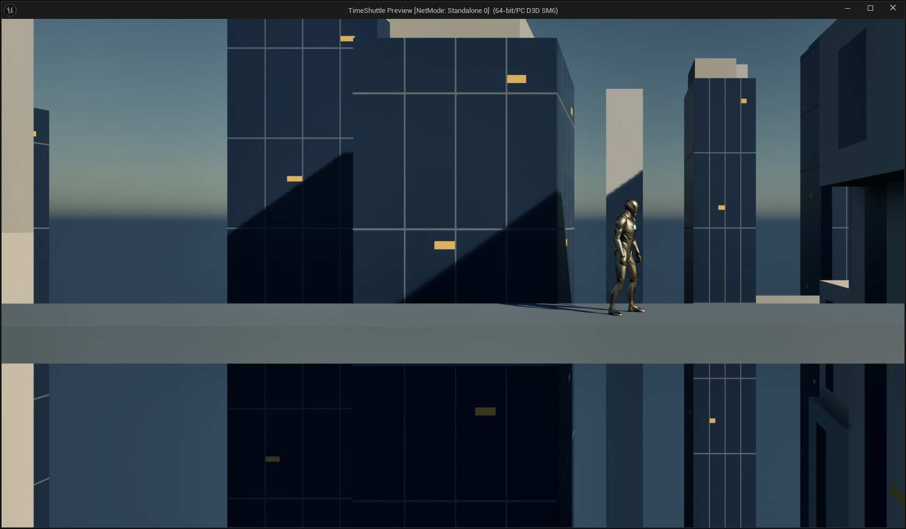
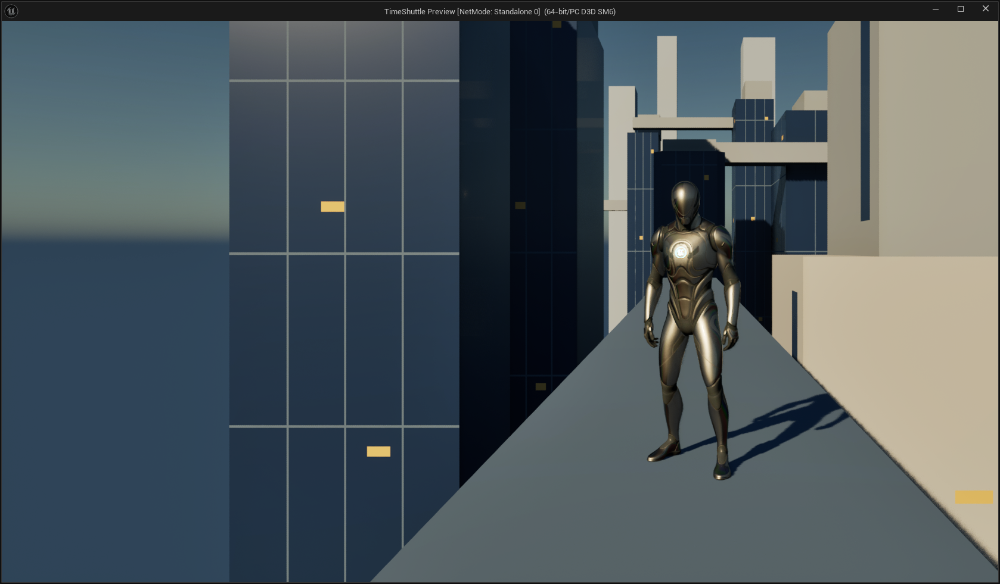

# 主界面城市场景 UE 接入开发进度

### Main menu hover-camera revision — 2026-10-25

Current Blueprint behavior supersedes the earlier L/dissolve flow: real mouse hover on New Game requests the front camera; OPTIONS/CREDITS/QUIT request side; empty space retains the last target. Keyboard/default focus does not request a camera, and the old L handler is a documented no-op. BeginNewGame keeps the empty-save-slot guard and locks menu input. If the rig is transitioning, phase 1 waits for OnViewSettled before CommitNewGame; if stable, commit immediately. There is no extra UI dissolve phase. TransitionSeconds remains editable on the level rig (1.2 s).

Controller, Button and Root compile/save; 64 scope/default checks pass, formatting preserves 31 graphs, authoring/cold hover runs each pass 37 checks. Three actual mouse-click travels reach Map_TrainingRoom with BP_FPCharacter, no visible menu or FX remnants; 62 fixed scene transforms stay identical. Cold editor has no TSVFXEditor, MainMenuScene is absent, .uproject hash is unchanged this task. Original five saves restored byte-for-byte after archiving test metadata; final world Map_MainMenu, PIE ended, zero dirty packages. One outdated comment was corrected; a cold test obscured by the BA welcome page was retained and rerun with the game viewport active. No font tests or new packaged build this revision; earlier Development package evidence is historical.

Canonical inspection record: `C:/Users/jason/Desktop/Capstone计划/开发文档/主界面/主界面UI.md`. Local scripts: `C:/Users/jason/Desktop/Capstone计划/tmp/main-menu-ui`; evidence: `Saved/Agent/MainMenuUI/hover_delivery_summary.json`. Runtime remains Blueprint/UMG/Niagara, without Python or custom runtime plugin dependencies.

更新：2026-10-25。关联 ART-001 / 2D-020 / GPD-004 / P-016；迁移任务 `20261025-main-menu-blueprint`。

**当前：MainMenuScene 运行时 C++ 插件已移出工程，`.uproject` 启用项已删除，关卡改为引擎原生父类的可编辑蓝图。冷启动后的 L 映射输入、轨道过渡和固定对象变换检查通过。UI/Niagara功能与Development打包回归已完成，见文末；美术逐像素一致性与整个P-016发行验收不因此全部通过。**

## 使用与参数

打开 `D:/UE5Project/TimeShuttle/TimeShuttle.uproject` 的 `/Game/Maps/Map_MainMenu`，Play 后鼠标悬停New Game切到正面，悬停其余按钮切回侧面，L入口已停用。过渡1.2秒，可中途反向；人物与建筑不换位。点击New Game时若过渡未完则等待真实完成回调，再进入Training Room；已稳定则立即提交，不再额外消散。

| 资产 | 作用与可编辑入口 |
| --- | --- |
| `/Game/Blueprints/MainMenu/GM_MainMenu` | GameModeBase 蓝图；专用 PlayerController，DefaultPawn=None |
| `BP_MainMenuController` | PlayerController 蓝图；BeginPlay 加载映射、初始化视图；L 的 Started 事件切换；EndPlay 移除映射 |
| `BP_MainMenuCameraRig` | Actor 蓝图 + 原生 CineCameraComponent；轨道计算、插值、构图；关卡实例 `MainMenu_CameraRig` |
| `/Game/Input/MainMenu/IMC_MainMenu` | L → IA_MainMenuToggle，优先级 10 |
| `IA_MainMenuToggle` | Boolean 输入；只响应 Started，长按不会反复往返 |

在 Rig 的 Details 调整 `TransitionSeconds`、`OrbitFocus`、`SideCamera`、`FrontCamera`。CineCamera Filmback/焦距可手调；不要移动人物来配合镜头。

| 对象 | 世界位置 cm | Pitch/Yaw/Roll |
| --- | --- | --- |
| Manny | (0,0,0) | (0,-90,0)，网格面向 +X |
| Camera_Side | (0,1000,135) | (0,-90,0) |
| Camera_Front | (450,0,135) | (0,180,0) |
| MainMenu_Sun | (0,0,2000) | (-30,-145,0) |

Rig 围绕 (0,0,135) 沿椭圆运动，角度 0 至 π/2，用 `t²(3−2t)` 插值。仅 Rig 移动，两台端点 CameraActor 固定。Filmback 为 36×20.25mm，偏移 −6.84/−1.863mm，焦距约25.706665mm，水平FOV70°，16:9；注视点投影约(0.69,0.408)。空闲关闭 Rig Tick。

关卡现有 **68** 个保存实例：原67个（59城市网格、Manny、两台相机、5光照环境）加1个 Rig。未重导入或重排城市，未修改默认启动地图、既有玩法地图、原 Manny 网格/骨骼/动画。

## 验证与边界

证据根目录：`D:/UE5Project/TimeShuttle/Saved/Agent/MainMenuBlueprint/`。

- `hot_validation.json`：342采样，244运动采样，12项通过；覆盖往返、过渡中反向，输入经临时编辑器工具的 L Pressed/Released 注入。
- `cold_validation.json`：新编辑器进程，MainMenuScene 与 TSVFXEditor 均未加载；270采样，142运动采样，11项通过。内置 `Input.+key L 1` / `Input.-key L` 各保持0.2秒，经真实 L 映射与 Started 蓝图事件触发，未直接调用 ToggleView。
- 冷启动往返时长 **1.2000799999 / 1.2000070997秒**；最大角速度1.962994rad/s，轨道最大数值误差约1.1e−16cm。
- 59城市、Manny和2端点相机共62对象的位置/旋转/缩放逐帧相同；原67对象在保存地图重载后也完全一致。
- 主点误差0.224像素，位于16:9画幅在1672×941整数视口中的半像素舍入范围内。
- `response_verify_saved_defaults_native_names.json`：第二次冷启动确认 CDO 和关卡实例均保留135cm焦点、1.2秒时长。
- `response_final_cold_check.json`：68保存实例，无 MainMenuScene/TSVFXEditor 包依赖，无脏包，PIE已结束。
- `response_verify_graphs_normalized.json`：图表整理前后10张图语义一致；Blueprint Assist 整理、职责注释、目视检查、编译保存已完成。

**输入证据限制**：Windows 自动化按键的按下/松开落在同一帧，UE 接收到了二者（`key_events.json`），但不会形成 Enhanced Input 的持续按下值。因此最终冷启动功能验收采用引擎内置跨帧键输入仿真，不能表述为“真人键盘长按验证”。未为这一自动化限制添加游戏逻辑补丁。

未验收整个游戏 Cook/打包、多平台。运行中出现的临时 SpectatorPawn 不是场景展示 Manny。原资产警告、观测脚本属性名错误与历史制作崩溃保留在日志，不混写为最终游戏错误。

## 冷启动发现并修正的问题

此前生成蓝图后，反射写入的默认值没有完整保留到重载：OrbitFocus 与 TransitionSeconds 变零。第一次冷启动数值验收因此失败，留存 `cold_*_defaults_failed.json`。修复为显式修改 CDO、编译、定向保存，并校正关卡实例；第二次冷启动通过。今后 UI 参数亦必须做保存重载检查。

制作时曾因异步格式化回调在保存期间重入编译导致编辑器退出。已改为先注销回调，再单次编译保存；恢复后图表与原场景校验通过。不要重跑旧的无重入保护脚本。

## 实际截图

以下由游戏视口的 `shot showui` 捕获，包含窗口边框；不是概念图或编辑器视口冒充。

## 移除、恢复与本地脚本

`Plugins/MainMenuScene/` 已不存在。其代码和二进制保留在忽略跟踪的 `Saved/Agent/MainMenuBlueprint/RemovedPlugin/MainMenuScene/`，不加载、不打包。`.uproject` 不再声明此模块。其余原有插件配置未改；没有提交或推送。

本地 Python 集中在上述证据目录及工作区 `tmp/main-menu-ue/`：`build_blueprint_menu.py` 生成原生蓝图图表；`install_blueprint_menu.py` 配置关卡；`format_blueprints.py` 整理注释；`fix_saved_defaults.py` 修正默认值；`cold_final_test.py`/`validate_blueprint_samples.py` 测试与分析；`bridge.py` 是受本地路径限制的编辑器任务入口。它们只在编辑器制作/测试时运行，不是运行时依赖。旧脚本具有历史顺序约束，不应无差别重跑。

## UI 下一阶段

按 `main-menu-ui-development.md` 的15批次执行，先分层、离线合成验收，再导入UE。最新用户要求：碎片由 **Niagara System** 计算制作，替代文档中的自定义 Slate C++ 组件；不新增 `.uproject` C++插件。研究与方案见 `Niagara二维碎片研究与实施记录.md`。标题使用单行纯白 TextBlock，保留原面板轮廓与半透明层次。

## Main menu UI / Niagara handoff — 2026-10-25

The menu now has 39 native assets under `/Game/UI/MainMenu`: editable UMG buttons/title, theme/region data, materials, fonts and CPU Niagara Sprite fragments. `NS_Menu2DFragments` uses a fixed 3144-slot pool (524 stable reference indices, 523 nonempty mattes) and an independent orthographic capture into UMG. Blueprint real time drives the effect, including pause/step/reset/dissolve. Gameplay and UI run without Python or the temporary authoring tool. No new runtime plugin or `.uproject` enable entry was added.

Cold editor without TSVFXEditor passed real-window L input, static actor checks, 14 runtime checks / 2704 samples, ten menu reopen cycles, six actual viewport sizes and the final five-minute one-widget/one-FX observation. Native Win64 Development build/cook/stage/pak/archive succeeded. Packaged regression uses UE CSV frame commands and Enhanced Input injection (not claimed OS clicks): L side/front/side, Options/Credits return and menu Quit succeeded, exit 0. Separate packaged New Game reached Map_TrainingRoom after camera/dissolve; GC reported zero menu widgets and FX actors, exit 0. Packaged tests use isolated user directories. Original four SaveGames hashes remain unchanged. Final editor is Map_MainMenu, PIE ended, no dirty packages, no authoring helper loaded.

New Game only uses a free Saved/Saved1/Saved2 slot; all occupied means an error and no travel. DeleteGameInSlot was rejected by automatic approval and is absent. Default game map/GameInstance remain unchanged. The direct AC_DialogueManager.StartLine ShowLine call pin was rebound from obsolete Line to DialogueLine so the actual destination dependency compiles; other links were preserved.

Evidence is local under `Saved/Agent/MainMenuUI/`: `final_handoff.json`, `final_cold_preflight.json`, `actual_l_validation.json`, `ui_runtime_qa.json`, `final_stability.json`, `final_memory_samples.json`, `pie_resolution_matrix.json`, `menu_format_validation.json`, `package-result.json`, `packaged-regression.log`, `packaged-newgame.log` and their result JSONs. Authoring scripts and backups also remain under Saved/Agent; they are not game runtime dependencies. The desktop project document workspace contains the Chinese UI implementation record, tuning guide, source-layer comparisons and 19.95-second native-frame demonstration video.

Pixel-identical art acceptance is NOT claimed: New Game/Options/mid-edge region MAE remains above 2/255 after matte refinement; native white title has small raster/layout differences from the offline font target. Credits production names remain editable/unfilled. Existing settings resolution initial selection and training DefaultSlot/NavMesh warnings were not expanded into this UI task. Shipping/low-end-device validation is not included. Early authoring-editor shutdown hit Blueprint preview teardown assertion; the final no-helper session remains open. Early CSV capture before RHI initialization hit an engine assertion; the test harness now starts CSV after initialization and both final packages exit cleanly. No crash report was uploaded.
