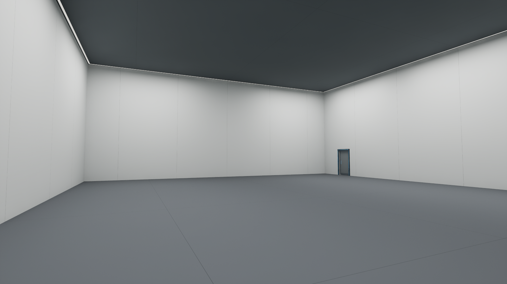

# Training room Level integration

Date: 2026-10-12. Engine verified: UE 5.6.1. Related records: LEVEL-002, ART-001, LD-053, DOC-001.

## Delivered scope

`/Game/Maps/Map_TrainingRoom` is an independent, enclosed indoor level built from the approved v5 Blender sliding-door model. Its clear interior is **20 × 24 × 8 m**, with a **1.2 × 2.2 m** doorway on the west wall near the south corner. The room contains only the architectural shell, flush light strips and entrance assembly. Tutorial props, enemies, stage logic and a permanent central marker are not included.

The user confirmed that the entrance should lead to **Map_LabBridge**. Approaching the door opens it; crossing the short entrance passage triggers travel to that map. The existing destination PlayerStart determines arrival. This is a one-way exit connection; a return connection in Map_LabBridge was not requested or added.

## Asset layout

| Location | Contents |
|---|---|
| `/Game/Maps/Map_TrainingRoom` | 37 authored actors; room, lights, exposure volume, PlayerStart, camera and two triggers |
| `/Game/Environment/TrainingRoom/Meshes` | 25 separately imported meshes, including the actual recessed wall pocket |
| `/Game/Environment/TrainingRoom/Materials` | 11 UE materials, including subtle world-space architectural seams and emissive light strips |
| `/Game/Environment/TrainingRoom/Blueprints/BP_TrainingDoor` | Player-only proximity trigger, 134 cm sliding movement over 0.8 seconds |
| `/Game/Environment/TrainingRoom/Blueprints/BP_TrainingExit` | Player-only overlap and Open Level by Object Reference to Map_LabBridge |
| `SourceAssets/TrainingRoom` | FBX sources and placement/material manifest; UE import paths updated to these retained sources |

Blender meters map to UE centimeters, with `(X,Y,Z)` converted to `(X,-Y,Z)`. The clear interior is X ±1000 cm, Y ±1200 cm and Z 0–800 cm. Entrance center is X=-1000 cm, Y=940 cm. Do not reinterpret the Blender +Y slide as UE +Y: the door opens toward UE -Y.

## Lighting and materials

- Six movable 550 × 550 cm Rect Lights at X ±600, Y -750/0/750, Z 780 cm, each 10,500 lumens and facing downward.
- One 500-lumen, 100 × 100 cm downward Rect Light in the short entrance passage.
- Two-sided, unlit ceiling perimeter strips; emissive RGB (30,29,27). Blue door accents use a lower emission level.
- An unbound PostProcessVolume fixes EV100 at 5, with bloom 0.18 and vignette 0.12. Lumen scene lighting and final gather quality are 4. Project-wide rendering settings remain unchanged.
- No Directional Light, Sky Light, Sky Atmosphere or exterior illumination was added. The ceiling and all four walls are enclosed meshes.
- Blender procedural shaders were recreated as simple UE materials; they are not claimed to be a byte-for-byte shader conversion.

## Door and travel behavior

`BP_TrainingDoor` is a TriggerBox instance centered at (-990,940,110) cm, half extents (160,85,110) cm. It filters `OtherActor` against player pawn 0. Its assigned `DoorLeaf` root moves from (-1020,940,113.5) to (-1020,806,113.5) over 0.8 s with ease-in/out. The inset and status light are attached to the door leaf. The door stays open after activation, avoiding automatic closure against the player. Re-entry targets the same open position.

The target vector is authored for this fixed room placement. If relocating or rotating the whole room, update the door's Move Component To target and both triggers together. This Blueprint is intentionally scoped to this Level rather than a general-purpose door framework.

`BP_TrainingExit` is centered at (-1195,940,110) cm, half extents (25,55,110) cm. It travels only when the actual player overlaps it. The destination uses a soft world-object reference, rather than a bare map-name string.

The map overrides GameMode with the existing `GM_FP`; PIE spawns and possesses `BP_FPCharacter`. It has one PlayerStart at (-750,940,96) cm, yaw -45°, facing into the room. Project startup/default maps and existing gameplay assets were not edited.

## Validation evidence

1. **Geometry and collision:** six center-outward traces hit the inner walls, floor and ceiling at X ±1000, Y ±1200, Z 0/800 cm, with less than 1 cm tolerance. Thirty vertical samples across the interior found no obstructing geometry between Z 20 and 780 cm. A closed-door trace hit the door leaf. Architecture uses complex-as-simple collision, while the moving door uses a box collision.
2. **Blueprints:** both new Blueprints compiled with zero errors and zero warnings. Blueprint Assist node refresh/format, structured comment boxes, another format pass and final compilation were performed. Both final graphs were inspected in the editor.
3. **Saved map reload:** switched away and loaded the saved map again. All 37 actors, the door's assigned mesh reference and `GM_FP` override were present. This is a saved-level reload, not a clean-process cold-start claim.
4. **PIE regression after final compilation/reload:** real `BP_FPCharacter` spawned at (-750,940,90.15), with control yaw -45°. Moving that player into the trigger opened the door to Y=806. A swept character move traversed the doorway to X=-1190 without being blocked. The exit overlap then loaded `/Game/Maps/UEDPIE_0_Map_LabBridge`, where a possessed `BP_FPCharacter` spawned at (0,-1040,90.15). The test did not directly call OpenLevel; travel was triggered by the authored overlap graph.
5. **Visual review:** the saved screenshot is an actual UE Lit-view capture. Corrected the initial light rotation, enabled the back side of the planar light-strip material, and adjusted exposure and emissive brightness before final review.
6. **Log/scope:** no `Error:` or `Accessed None` entries were found in this task editor log after testing. Import reported missing FBX smoothing-group metadata; this is an importer warning, not a gameplay validation failure. Existing unrelated VFX changes were present at baseline and were not saved by this task. No commits or pushes were made.

Evidence: [shell traces](TrainingRoom/shell_validation.json), [PIE regression](TrainingRoom/regression_result.json), [map reload](TrainingRoom/reload.json), and final graph/compiler summaries in the same folder. Task-local scripts and full logs remain under `Saved/Agent/TrainingRoom` and `Saved/Logs/TrainingRoomEditor.log`.

## Remaining scope

This completes the requested empty room import, indoor lighting and entrance-to-Level connection. The three-stage tutorial, enemy spawning, training-state door lock, OMEN dialogue, audio and return travel are not implemented by this change. No packaged build, controller playtest, frame-rate benchmark or shipping/cooking validation was performed. Include the training room in the shipping map/cook configuration when integrating it into the release flow.

To inspect: open `/Game/Maps/Map_TrainingRoom`, press Play, approach the blue-framed door, and walk through the short passage. To roll back this addition, remove only the new training map, its dedicated Environment/TrainingRoom assets, retained sources and this documentation; do not reset unrelated project changes.
