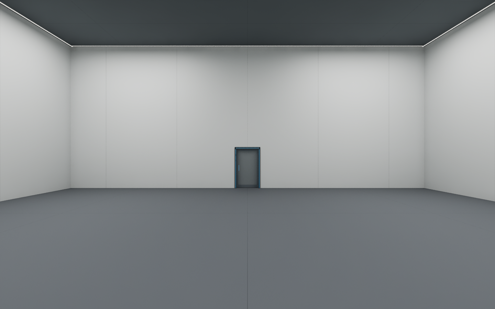
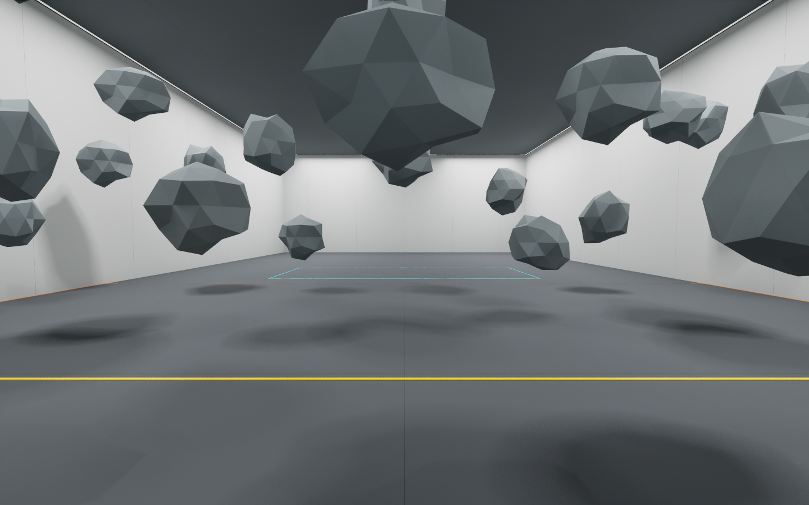
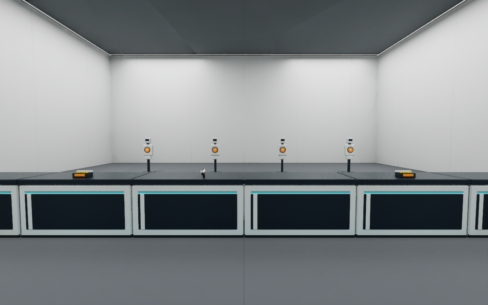
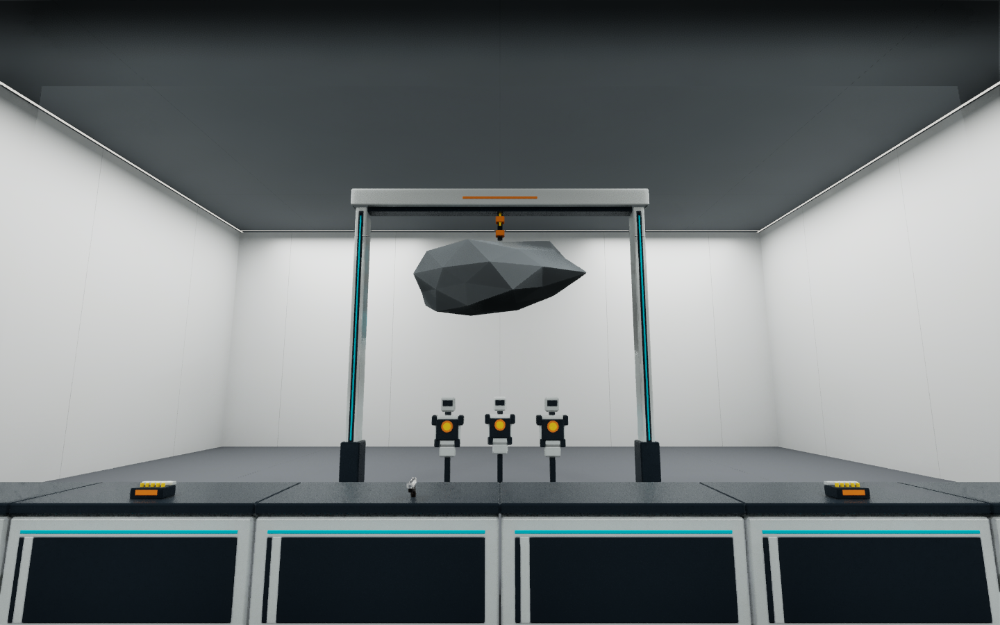
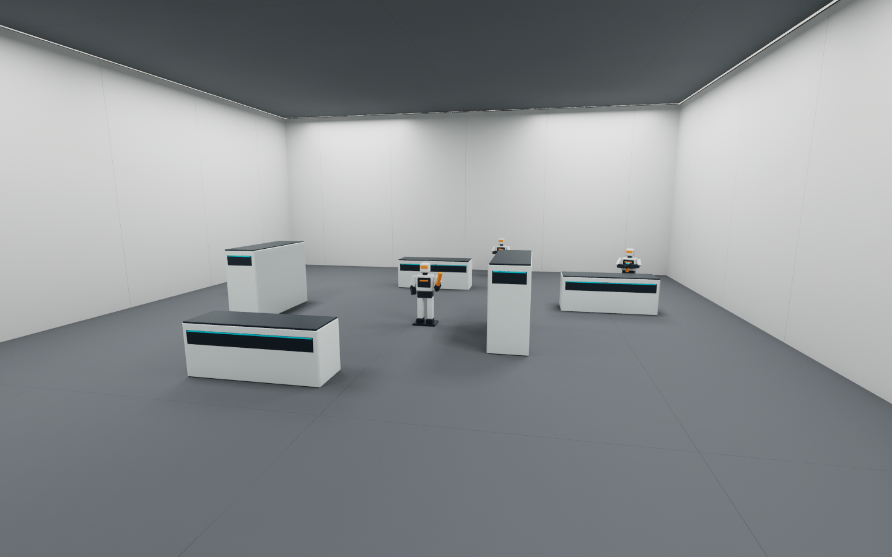

# Training Room 阶段场景交付

2026-10-13。关卡：`/Game/Maps/Map_TrainingRoom`。

## 直接使用

UE 顶部新增 **Training Stages** 菜单，选择 S1、S2、S2C、S3、S4、S5、S6、S7A 或 S7B。菜单同时设置物体显示、游戏内隐藏和碰撞；保存关卡后，Play 使用所选布景。当前保存为 **S1**。

Outliner 的 `TrainingStages` 下分阶段整理。`00_SHARED_S3_to_S7A` 是共享补给桌、4 个弹药刷新位置、手枪展示和玩家阻挡。S3～S7A 自动显示这组，S7B 自动撤去。Outliner 眼睛仅适合临时查看，完整预览请用顶部菜单。

切换不会移动 PlayerStart、玩家或编辑器视角。此工具用于编辑阶段布景，Play 运行中禁止编辑切换。地图重开时根据保存的游戏内隐藏状态恢复编辑器显示。

Blender 源场景：`SourceAssets/TrainingStages/TrainingRoom_StageLayouts.blend`。右上 View Layer 选择阶段，可显示相应 Collection 及共享组。已将该场景附加到当前打开的 Blender，原来的 `Scene` 仍保留，未覆盖原会话文件。实际 UE 关卡是最终摆放依据。

## 已完成布景

| 阶段 | 内容 | 物件数，不含共享组 |
|---|---|---:|
| S1 | 入口至中央的全宽落石区域、28 块悬停落石、触发带与中央完成区域地线 | 37 |
| S2 / S2C | 前方射手；S2C 增加侧方射手 | 1 / 2 |
| S3 | 4 个静止训练靶 | 4 |
| S4 | 3 个装甲靶及移动范围轨道 | 6 |
| S5 | 门架、吊石、独立连接点、落点边界和3个装甲靶 | 11 |
| S6 | 吊石环境题、3个落点靶、2个移动靶及轨道 | 15 |
| S7A | 桌子玩家侧的近战预览位置 | 1 |
| S7B | 3低2高错落掩体，1近战3远程代理 | 9 |
| 共享组 | 10段封闭桌、4个弹药展示、手枪展示、玩家阻挡 | 16 |

合计 **101 个阶段物件、13 种新静态模型、7 个材质**。新资源在 `/Game/Environment/TrainingRoom/Stages`，FBX 和两份 Blender 源文件在 `SourceAssets/TrainingStages`。

## 保留房间与入口修正

现场墙体已经由组员加长。以本次实时测量为准：内净 **20 × 34.7 × 8 m**，X=-1000～1000、Y=-2270～1200、Z=0～800 cm。旧文档的20×24m是历史尺寸。沿用地板、顶、长墙、远端墙与灯光；道具沿现有纵深展开，单件尺寸不拉伸。

入口按确认移到短边中央 `(0,1200)` cm，保留120×220cm净门洞。旧西墙洞补齐，南端墙拆分出真实门洞。门框、通道、灯、开门触发和出口触发一起移位。玩家初始位置 `(0,1040,100)`，朝向-Y，进入后前往中央。中央仅为S1完成区域，不是换场回位点。

原 `BP_TrainingDoor` 使用固定相对滑动终点。新增持久父物体 **Door Motion Space**：位置 `(-940,200,0)`、Yaw=-90°、Scale=1；保留门叶旧相对坐标。闭合门叶世界位置 `(0,1220,113.5)`，开启后 `(-134,1220,113.5)`。面板和灯仍附着门叶。维护时不要单独解除门叶父级。出口依旧连接 `Map_LabBridge`。

TrainingRoom 原来缺少 `BP_ReverseSystemManager`，实际玩家会反复访问空引用。本次仅在 `TrainingRoom/00_SYSTEMS` 补放项目已有 Manager；未修改时间系统蓝图或其他关卡。

## 碰撞与检查结果

- 13个FBX逐件回读；UE导入尺寸、材质槽均验证。
- 101个阶段物件的包围盒均位于现有房间范围内；9种预览组合检查通过。
- 10段桌连续封至两侧墙。不可见阻挡只阻挡Pawn，不阻挡Visibility/Projectile；地面和桌上高度的实际玩家胶囊都无法跨过。
- 使用真实 `AC_Vault.CanVault` 在5个横向位置×4个距离测试：阻挡开启20/20拒绝翻越，关闭阻挡作为对照有10个位置允许翻越。
- 从桌前向S3靶子的Visibility射线越过桌面和阻挡，命中 `S3 | StaticTarget_3`。
- PIE验证滑门移动134cm、玩家胶囊穿过门洞、出口进入 `Map_LabBridge`。
- 保存重开后，门父级、101个阶段物件、碰撞设置、初始S1显示保留。地图检查0 Error、0 Warning。
- 补入Manager后玩家Controller引用有效，未再出现Manager空引用。项目已有 `ABP_FP_ArmsProcedural` 重复DefaultSlot警告未在本次修改。

验证明细与原关卡恢复备份在 `Saved/Agent/TrainingStages`。本次未提交或推送Git。

## 仍需接入的玩法

这是完整的**阶段场景摆放与预览**。射手、近战、靶子为静态代理；弹药/手枪为展示与生成位置。尚未接入阶段推进、融化效果、落石/伤害/弱点判定、移动靶动画、AI攻击、拾取和弹药自动刷新。挂接时用 `TSStage:*`、`TSId:*` 标签定位物件。

运行时换场必须同步显隐与碰撞，在玩家当前位置检查新道具占位，避免生成桌子或掩体将玩家夹住。融化可以更换道具，但不能强制移动玩家。S7B需停止补给并清除未拾取弹药，保留玩家已携带装备。

## UE 实景预览

